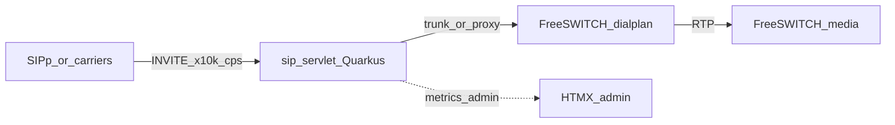

# Architecture — sip-freeswitch

## Roles

| Component | Owns | Does not own |
|-----------|------|----------------|
| **sip-servlet** | SIP signaling (INVITE/BYE/…), proxy toward FreeSWITCH, metrics | RTP / media |
| **FreeSWITCH** | Dialplan, media (RTP), lab endpoints | 10k CPS plane |
| **SIPp loadtest** | CPS ramp / acceptance | Production traffic |

## Flow

## Phase-0 honesty

Scaffold + lab compose + SIPp harness. Capacity claim only after [`capacity-acceptance.md`](capacity-acceptance.md) is green.

## Protocol

- Never break SIP transaction state machine (RFC 3261).
- Prefer immutable event payloads; avoid blocking IO on SLEE ER threads.
- Hot-path logging: DEBUG/TRACE only for message bodies.
