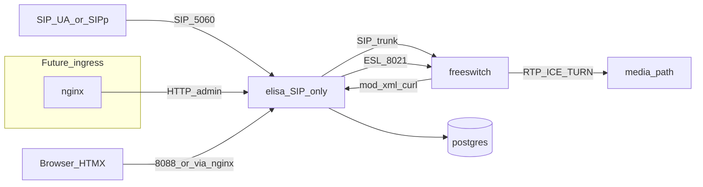

# Architecture — sip-freeswitch / Elisa

## Locked shape

**SIP signaling only — not an SBC.** Elisa terminates/proxies SIP toward FreeSWITCH; RTP never hairpins through Elisa. Later, **nginx** sits in front (admin HTTP first; optional L4 for SIP TCP/TLS). Elisa keeps the SIP transaction state machine.

| Component | Owns |
|-----------|------|
| **nginx** (later) | TLS/HTTP front for admin; optional stream for SIP TCP — **not** SIP dialog SM |
| **elisa** | SIP signaling edge (CPS), HTMX admin, ESL, xml_curl, CDR, ACL |
| **freeswitch** | Dialplan, media, Sofia |
| **coturn / ICE** | **rtp_redirect** media path through firewall (TURN relay) — not Elisa RTP |
| **postgres** | Config, tenants, extensions, CDR |
| **Infinispan** | Dialog/session checkpoints (C1); PG remains config/CDR SoT |

Cluster VIP + Sofia affinity: [`cluster-c2-vip-affinity.md`](cluster-c2-vip-affinity.md).

## Explicit non-goals (SBC)

Do **not** grow Elisa into:

- RTP/SRTP media relay or topology-hiding media anchor
- Full session-border product (transcoding farm, SIP-I/SIP-T gateway farm)
- IMS CSCF roles (P/I/S-CSCF) or Diameter as core product in this tree

3GPP readiness = **SIP header / dialog / transaction compliance** so interconnect can extend to VoLTE/VoNR later — see [`3gpp-sip-ims.md`](3gpp-sip-ims.md).

**rtp_redirect** (required): media RTP must traverse the firewall via TURN / FS RTP ports — Elisa enforces SDP policy + FS `bypass_media=false`; it does not relay RTP. See [`media-ice-turn.md`](media-ice-turn.md).

Capacity: **10 000 INVITE/s** on elisa signaling — claim only after SIPp green.
