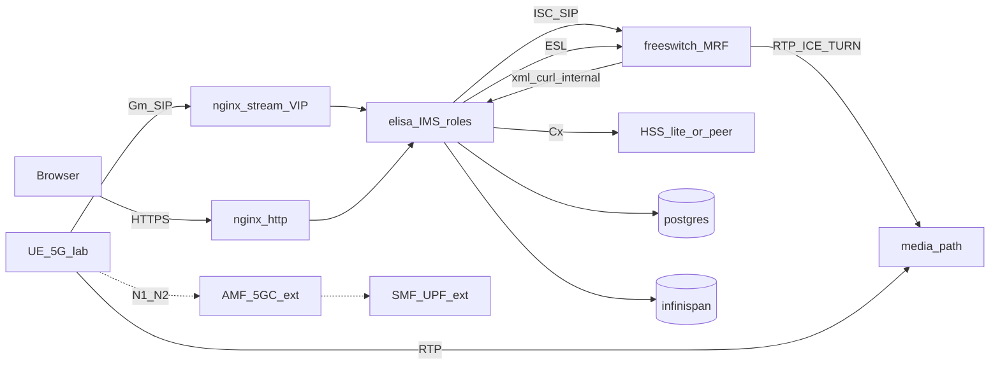

# Architecture — sip-freeswitch / Elisa

## Locked shape (IMS Core pivot — grill I1–I8)

**SIP/IMS signaling only — not an SBC.** Elisa runs feature-flagged P/I/S-CSCF (+ optional HSS-lite). **FreeSWITCH is an essential MRF/AS + ESL control-plane component** (voice / ICE / TURN / ISC AS / xml_curl) — Elisa without FS is an **incomplete** lab; never document “run Elisa without FreeSWITCH” as a supported full-IMS path. Soft-fail ESL when FS is down is OK; compose must still include FS (1:1 with each S-CSCF in N–N). RTP never hairpins through Elisa.

| Component | Owns |
|-----------|------|
| **nginx** | Edge VIP: HTTPS → `:8088`; SIP L4 stream → `:5060` — [`nginx-ingress.md`](nginx-ingress.md) |
| **elisa** | CSCF roles (flags), Cx, HSS-lite, HTMX admin, ESL client, xml_curl, CDR, ACL |
| **freeswitch** | **Essential** MRF/AS dialplan, media, Sofia, ESL peer — mandatory in every full voice lab / N–N pair |
| **coturn / ICE** | **rtp_redirect** — not Elisa/nginx RTP |
| **postgres** | Config, tenants, IMS profiles/bindings, call sessions, CDR |
| **Infinispan** | Dialog + registration + call-session (C1/P2) |
| **5GC (external)** | AMF/SMF/UPF — PDU / mobility; **not** in Elisa |

**5G note:** Voice enters on **Gm** via nginx SIP VIP → Elisa P-CSCF. Full call flows: [`ims-core.md`](ims-core.md) § *5G → CSCF boundary*.

Detail: [`ims-core.md`](ims-core.md) · Ingress: [`nginx-ingress.md`](nginx-ingress.md). Profiles: [`user-profile.md`](user-profile.md) · JAIN SLEE 1.1 ProfileFacility: [`jainslee-profile.md`](jainslee-profile.md). Datastore: [`datastore.md`](datastore.md). Cluster: [`cluster-c2-vip-affinity.md`](cluster-c2-vip-affinity.md). Call continuity: [`cmp-recovery.md`](cmp-recovery.md) · dead-SBB orchestrator (design): [`sbb-recovery-manager.md`](sbb-recovery-manager.md). Media: [`media-ice-turn.md`](media-ice-turn.md). ESL: [`ra-freeswitch.md`](ra-freeswitch.md).

## Explicit non-goals (SBC)

Do **not** grow Elisa into:

- RTP/SRTP media relay or topology-hiding media anchor
- Full session-border product (transcoding farm, SIP-I/SIP-T gateway farm)
- FreePBX as the signaling controller
- AMF/SMF/UPF (5GC) inside this process

IMS CSCF + Cx **are in scope** (lab); PCRF Rx/N5 / MGCF deferred.

**rtp_redirect** (required): media via TURN / FS RTP; Elisa enforces SDP policy + FS `bypass_media=false`. See [`media-ice-turn.md`](media-ice-turn.md).

Capacity: **10 000 INVITE/s** on signaling — claim only after SIPp green.
