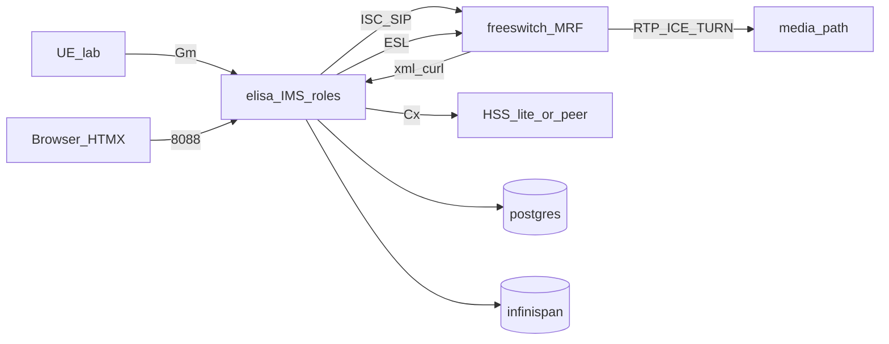

# Architecture — sip-freeswitch / Elisa

## Locked shape (IMS Core pivot — grill I1–I8)

**SIP/IMS signaling only — not an SBC.** Elisa runs feature-flagged P/I/S-CSCF (+ optional HSS-lite); FreeSWITCH is MRF/AS media. RTP never hairpins through Elisa.

| Component | Owns |
|-----------|------|
| **elisa** | CSCF roles (flags), Cx, HSS-lite, HTMX admin, ESL, xml_curl, CDR, ACL |
| **freeswitch** | MRF/AS dialplan, media, Sofia |
| **coturn / ICE** | **rtp_redirect** — not Elisa RTP |
| **postgres** | Config, tenants, IMS profiles/bindings, call sessions, CDR |
| **Infinispan** | Dialog + registration + call-session (C1/P2) |

Detail: [`ims-core.md`](ims-core.md). Profiles: [`user-profile.md`](user-profile.md) · SLEE 1.1 ProfileFacility: [`jainslee-profile.md`](jainslee-profile.md). Datastore: [`datastore.md`](datastore.md). Cluster: [`cluster-c2-vip-affinity.md`](cluster-c2-vip-affinity.md). Call continuity: [`cmp-recovery.md`](cmp-recovery.md) · dead-SBB orchestrator (design): [`sbb-recovery-manager.md`](sbb-recovery-manager.md).

## Explicit non-goals (SBC)

Do **not** grow Elisa into:

- RTP/SRTP media relay or topology-hiding media anchor
- Full session-border product (transcoding farm, SIP-I/SIP-T gateway farm)
- FreePBX as the signaling controller

IMS CSCF + Cx **are in scope** (lab); PCRF Rx/N5 / MGCF deferred.

**rtp_redirect** (required): media via TURN / FS RTP; Elisa enforces SDP policy + FS `bypass_media=false`. See [`media-ice-turn.md`](media-ice-turn.md).

Capacity: **10 000 INVITE/s** on signaling — claim only after SIPp green.
