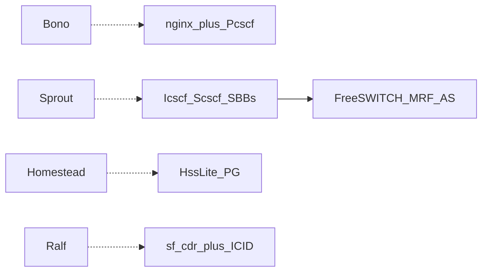

# Clearwater / Alianza vs Elisa — feature parity

Map Clearwater (open-source Metaswitch + commercial Alianza Core IMS) **functions** onto Elisa lab IMS Core. Elisa does **not** clone Vellum/Chronos/Cassandra.

Sources: [Clearwater Architecture](https://clearwater.readthedocs.io/en/stable/Clearwater_Architecture.html) · [Alianza Clearwater Core](https://www.alianza.com/products/clearwater-core-ims/) · GitHub: sprout, homestead, ralf, crest, ellis, chronos.

## Component map

| Clearwater / Alianza | Role | Elisa | Gap status |
|----------------------|------|-------|------------|
| **Bono** | P-CSCF / Gm edge | nginx L4 VIP + `PcscfProxySbb` | Partial — Mw forward OK; no WebRTC/IPsec |
| **Sprout** | I/S-CSCF, iFC, MMTel AS | I/S SBBs + `IscAsRouter` → **FreeSWITCH** (essential MRF/AS) | Partial — MMTel-lite barring/diversion/privacy; no BGCF product |
| **Homestead + Cx** | HSS / Cx | `HssLiteService` + `CxClient` / PG | Lab Cx AVP set |
| **Homer (XDMS)** | XCAP MMTel | PG `ims_mmtel_settings` + REST-lite | Homer-lite (not full XDMS) |
| **Ralf + CCF** | Diameter Rf CTF | FS JSON → `sf_cdr` + ICID / P-Charging-Vector; Rf emitter flagged | CDR-first; Rf optional |
| **Vellum** | Cassandra / Chronos | PG + Infinispan | Different HA (OK) |
| **Ellis** | Self-care | HTMX admin / portal | Different surface (OK) |
| **Perimeta** | SBC | Non-goal | Never |
| **BGCF** | Breakout | Config stub `sf.ims.bgcf.uri` | Stub |
| **ENUM** | Number resolve | Feature flag off | Deferred |

## Phases

| Phase | Scope | Done when |
|-------|--------|-----------|
| **A** | Gap doc + CDR IMS fields + P-Charging-Vector | ✅ `clearwater-parity.md`; V6 `sf_cdr` ICID/IMPU/…; admin columns |
| **B** | Mw split, multi-AS iFC, reg expiry, BGCF stub | ✅ `IscAsRouter.asChain`; `BindingExpiryScheduler`; `sf.ims.bgcf.uri` |
| **C** | MMTel-lite barring/diversion/privacy | ✅ `MmtelService` + V7 `ims_mmtel_settings` |
| **D** | Later | WebRTC, full Rf interconnect, Perimeta, Chronos, VoLTE PICS |

## Success criteria

- Parity matrix checked in (this file)
- Answered call → `sf_cdr` with `sip_call_id` + ICID (+ msisdn when known)
- Admin CDR shows IMS correlate fields
- Phase B/C green under `et.elisa.ims.**`
- Claim: **Clearwater-equivalent lab IMS Core functions on Elisa + FreeSWITCH + CDR** — not “Clearwater clone”

## Related

- [`ims-core.md`](ims-core.md) · [`ims-protocol-roadmap.md`](ims-protocol-roadmap.md) · [`3gpp-sip-ims.md`](3gpp-sip-ims.md) · [`elisa-improve-plan.md`](elisa-improve-plan.md)
