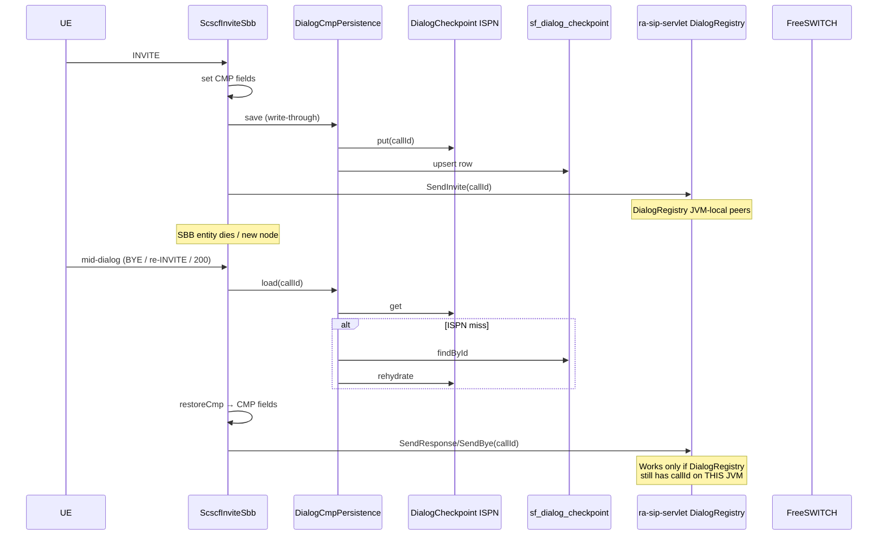

# CMP recovery — SBB die → ISPN/PG → continue call

**Status:** lab implemented (app-level CMP + dual write).  
**Related:** [`jainslee-profile.md`](jainslee-profile.md) (shared ProfileFacility), [`datastore.md`](datastore.md), micro-jainslee `CmpBackedSbb` / `@CmpField`.  
**Orchestrator:** [`sbb-recovery-manager.md`](sbb-recovery-manager.md) — **PARTIAL** (local respawn + fencing + portable DialogRegistry peers).

---

## 1. Goal

When an SBB entity dies (passivate/fail/recreate), **call and user correlate state must be recoverable** so mid-call signalling can continue. Elisa persists invite/session CMP to:

| Tier | Store | Key |
|------|--------|-----|
| Hot | Infinispan `DialogCheckpointStore` / `CallSessionStore` | `sipCallId` / `fsUuid` |
| Durable | Postgres `sf_dialog_checkpoint` / `sf_call_session` | same |

Load order on restore: **ISPN → PG** (rehydrate ISPN on PG hit).

---

## 2. CMP fields (JAIN SLEE 1.1 §6.5)

### `ScscfInviteSbb` (extends `CmpBackedSbb`)

| CMP | Notes |
|-----|--------|
| `sipCallId` | Entity correlate / Send* Call-ID |
| `fsUuid` | FS Unique-ID (filled on CHANNEL_*) |
| `msisdn` | Resolved identity |
| `fromUri` / `toUri` | Dialog parties |
| `trunkUri` | ISC AS / MT contact target |
| `peer` | Optional ingress peer |
| `fsNodeId` / `elisaNodeId` | Affinity |
| `dialogState` | `INVITE` → `EARLY` → `CONFIRMED` → `TERMINATED` |
| `startedAtEpochMs` / `updatedAtEpochMs` | Timestamps |

Concrete class: `ScscfInviteSbb.$Concrete` (local map + `cmpWrite` when container store bound).

### `CallSessionSbb`

| CMP | Notes |
|-----|--------|
| `fsUuid`, `sipCallId`, `msisdn` | Correlate |
| `fromUri`, `toUri`, `direction` | FS headers |
| `fsNodeId`, `elisaNodeId` | Nodes |
| `dialogState` | CREATE / ANSWER / HANGUP… |
| timestamps | |

Write-through: `CallSessionService` (ISPN + PG + Profile) and `DialogCmpPersistence` link FS uuid back onto dialog CMP.

---

## 3. Sequence — SBB die → recover → continue

**App recovery API:** `ScscfInviteSbb.recoverAfterFailure(sipCallId)` / `CallSessionSbb.recoverAfterFailure(fsUuid)` — used in unit tests; production path is `sbbActivate` + `ensureCmpLoaded` on mid-dialog events.

---

## 4. Write-through points

| Event | Action |
|-------|--------|
| INVITE | CMP = INVITE; `DialogCmpPersistence.save` |
| 1xx | CMP = EARLY; save |
| 2xx / SDP | CMP = CONFIRMED; save |
| 4xx+ / BYE | CMP = TERMINATED; `remove` (ISPN drop + PG `ended_at`) |
| CHANNEL_CREATE/ANSWER | `CallSessionService.upsertFromFs` + dialog CMP `withFs` |
| CHANNEL_HANGUP | end session + dialog CMP remove |

---

## 5. RA HA gap (honest)

`ra-sip-servlet` **`DialogRegistry` is JVM-local** (`ConcurrentHashMap` of Call-ID → peer addresses / last request). App CMP restores **routing metadata** (URIs, FS uuid, state, nodes) but does **not** rebuild:

- UA / trunk `InetSocketAddress` peers  
- last SIP request/response objects  
- activity handle wiring inside the RA  

Therefore:

| Scenario | App CMP | Full mid-call SIP continue |
|----------|---------|----------------------------|
| SBB entity recreate **same JVM**, DialogRegistry intact | Yes | Yes (Send* by Call-ID) |
| Process crash / fail over to **other Elisa node** | Yes (ISPN DIST / PG) | **No** until RA DialogRegistry is clustered or rebuilt from wire |

### Follow-up (concrete)

1. **RA:** Cluster or checkpoint `DialogRegistry.Dialog` (peer, remotePeer, transport, cseq) into ISPN keyed by Call-ID — or reconstruct peers from CMP `peer` + trunk URI on first recovered Send*.  
2. **IES:** Initial Event Selector convergence on SIP Call-ID so one SBB entity per dialog (passivate/activate CMP via container `CmpFieldStore`).  
3. **Optional:** Custom `CmpFieldStore` dual-writing entity maps to ISPN (today Elisa write-through is explicit via `DialogCmpPersistence`, not the default in-memory container store).

Until (1), sticky L4 affinity (Call-ID / source IP) remains mandatory for mid-dialog — see [`cluster-c2-vip-affinity.md`](cluster-c2-vip-affinity.md).

---

## 6. Code map

| Piece | Path |
|-------|------|
| CMP snapshot | `et.elisa.cmp.InviteCmpSnapshot` |
| Dual persist | `et.elisa.cmp.DialogCmpPersistence` |
| ISPN record | `et.elisa.cluster.DialogCheckpoint` (+ `dialogState`) |
| PG entity | `et.elisa.persist.SfDialogCheckpoint` / table `sf_dialog_checkpoint` |
| Invite SBB | `et.elisa.ims.scscf.ScscfInviteSbb` |
| Session SBB | `et.elisa.session.CallSessionSbb` |
| Tests | `et.elisa.cmp.InviteCmpRoundTripTest` |

---

## 7. Grill note vs Profile (C9)

- **ProfileFacility** (`CallSessionProfile` / `ImsSubscriberProfile`) = shared hot map across SBBs.  
- **SBB CMP** = entity-local dialog handler state + `profileKey`/`sipCallId`/`fsUuid` pointers.  
Both dual-write in lab; CMP recovery is the path when the **handler entity** dies; Profile remains the cross-SBB lookup.
