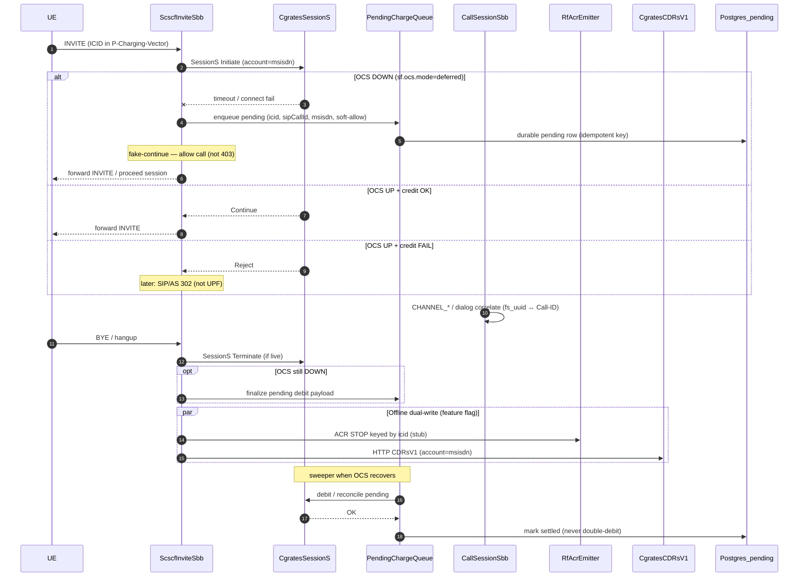

# Elisa improve plan (grill G1–G5)

**Locked:** 2026-08-10 (user). **Status:** Phase A + B stub + Phase C scaffold implemented (2026-08-10).  
**Pointer from:** [`ims-core.md`](ims-core.md) § Charging.

Lab IMS Core charging / OCS path: offline CDR dual-write (Rf ACR stub + CGRates **CDRsV1**) then SessionS online with **deferred debit** when OCS is down. Not an SBC; no RTP; no PFCP/Gx/Gy.

---

## 1. Grill locks

| Id | Answer | Lock |
|----|--------|------|
| **G1 slice** | **B** | Jump to Rf / CGRates client next. Hygiene (Throwable + `SleeEventTrace`) is **not** blocking the first PR; still apply when touching SBBs. |
| **G2 P1 offline** | **C** | Both: Diameter **Rf ACR stub** in path **and** HTTP CGRates **CDRsV1** dual-write, behind feature flag(s). |
| **G3 OCS down** | **Deferred debit / fake-continue** | When OCS (CGRates SessionS) **down** → allow call with synthetic/soft credit decision (“fake” continue). When OCS **recovers** → reconcile and debit. **Not** hard 403. Config: `sf.ocs.mode=deferred` (or similar). Footgun: **no double-debit** — durable pending charge keyed by `icid` / `sipCallId`. When OCS **UP** and credit fails → SIP/AS **302** later (not UPF redirect). |
| **G4 CGRates** | **C** | Optional compose profile **`cgrates`** (sidecar when profile on; else external URL via props). **Account key default: `msisdn`** (IMS profile SoT); resolve via HssLite / `ims_subscriber`; if `msisdn` null → soft-fail to `impi` for lab. |
| **G5 pool** | **40960** | Set / keep `microjainslee.container.sbb-pool-max=40960` now. Capacity verdict only after SIPp / other SIP load tool — **do not claim 10k** until green ([`capacity-acceptance.md`](capacity-acceptance.md)). |

### Already locked never

| Never | Reason |
|-------|--------|
| **PFCP / N4** | No SMF/UPF ownership; SIP URI in PFCP Redirect is Gy/Ro heritage, not IMS Core |
| **Gx** | No PCRF/PCEF ownership |
| **Gy** | Credit on Diameter Gy user-plane path — out; map credit UX to SIP/AS |
| **Gx-over-Gy** (App-Id 16777225) | Legacy mashed App-Id — do not resurrect |
| **RTP through Elisa** | Media on FreeSWITCH (+ TURN/ICE); Elisa = SIP + control |
| **SBC** | No topology hiding / media anchoring product claims |

---

## 2. Sequence — INVITE → OCS down → CallSession → OCS up debit + CDR dual-write



**Idempotency:** pending charge PK = `icid` preferred, else `sipCallId`; sweeper must be at-most-once debit after successful SessionS/AccountS charge.

---

## 3. Phases (implementation order)

### Phase A — CGRates HTTP client + CDRsV1 — **DONE**

- [x] CDI `@ApplicationScoped` CGRates HTTP client (Java 25, Log4j2 — **no Camel**).
- [x] **CDRsV1** post path + feature flag (`sf.cgrates.cdrs.enabled` + `sf.charging.dual-write`).
- [x] Optional compose profile **`cgrates`** (sidecar when on; else `sf.cgrates.url` / props to external).
- [x] Account resolution: **msisdn** from HssLite / `ims_subscriber`; null → soft `impi`.
- [x] Bump `microjainslee.container.sbb-pool-max=40960` in `application.properties` (+ dist template).
- [x] Throwable + `SleeEventTrace` on touched SBBs (`CallSessionSbb`, `ScscfInviteSbb`).

### Phase B — Rf ACR stub + dual-write — **DONE (stub)**

- [x] Diameter **Rf ACR stub** (`RfAcrEmitter` / `LoggingRfAcrEmitter`) keyed by **`icid`**.
- [x] Dual-write with CDRsV1 behind `sf.charging.dual-write` (+ `sf.rf.enabled` / `sf.cgrates.*`).
- [x] Still offline only; no SessionS gate yet.
- [ ] Wire real Diameter Rf ACR via `ra-diameter` (follow-up).

### Phase C — SessionS + deferred-debit queue — **scaffold only**

- [x] `PendingCharge` / `PendingChargeStore` / in-memory store + `PendingChargeSweeper` stub.
- [ ] CGRates SessionS **Initiate / Update / Terminate** client.
- [ ] Durable **Postgres** pending-charge queue + real sweeper debit.
- [ ] INVITE-path gate: `sf.ocs.mode=deferred` fake-continue + enqueue; OCS UP + credit fail → SIP/AS **302**.
- [ ] Reconcile on OCS recovery; **forbid double-debit** (store markSettled is ready).

### Hygiene (cross-cutting)

- [x] Touched SBBs: catch/log **Throwable**; emit **`SleeEventTrace`**.
- [x] Pool: `microjainslee.container.sbb-pool-max=40960` — **no 10k CPS claim** until SIPp green.

---

## 4. Engineering constraints

| Rule | Detail |
|------|--------|
| **JDK** | Java **25** only (`mise` → `zulu-25`) |
| **Logging** | Log4j2 only — no SLF4J/logback dual |
| **Types** | Prefer **immutable records** for commands / CDR / pending payloads |
| **No Camel** | HTTP client stays plain CDI / JDK HttpClient (or existing Elisa HTTP style) |
| **No SBB instance maps** | Activity / CMP / store — not `Map` on SBB instance fields for dialog state |
| **Link truth** | OCS/CGRates “live” = peer evidence (HTTP/SessionS), never “config applied” |
| **Prove artifact** | Package → ship `dist/elisa/` → restart → prove live path ([`packaging.md`](packaging.md)) |

---

## 5. Explicit non-goals

- PFCP/N4, Gx, Gy, Gx-over-Gy, PCRF Rx/N5, PCEF
- RTP / media through Elisa; SBC / topology hiding
- Hard **403** when OCS down under `sf.ocs.mode=deferred`
- Claiming **10 000 INVITE/s** before SIPp (or agreed SIP load tool) green
- Blocking Phase A on full SBB hygiene sweep (G1=B)
- Shipping Camel, Spring WebClient stacks, or WAR packaging for Digicom
- Double-debit / best-effort-only pending without durable key

---

## 6. Pointers

| Doc | Role |
|-----|------|
| [`ims-core.md`](ims-core.md) § Charging | Grill summary + link here |
| [`lessons.md`](lessons.md) § PFCP / Gx / Gy + improve locks | Footguns + deferred-debit |
| [`capacity-acceptance.md`](capacity-acceptance.md) | 10k gate |
| [`user-profile.md`](user-profile.md) | IMS profile / msisdn SoT |
| [`architecture.md`](architecture.md) | Not-SBC shape |

---

## Suggested property knobs

```properties
# Phase A
sf.cgrates.enabled=false
sf.cgrates.url=http://127.0.0.1:2080
sf.cgrates.cdrs.enabled=false
sf.cgrates.account-key=msisdn
sf.charging.dual-write=false
microjainslee.container.sbb-pool-max=40960

# Phase B
sf.rf.enabled=false

# Phase C
sf.ocs.mode=deferred
sf.ocs.session.enabled=false
sf.ocs.pending.sweep-interval-sec=30
```

Compose: profile `cgrates` starts sidecar (`docker-compose.services.yml`); without profile, URL points at external CGRates.
