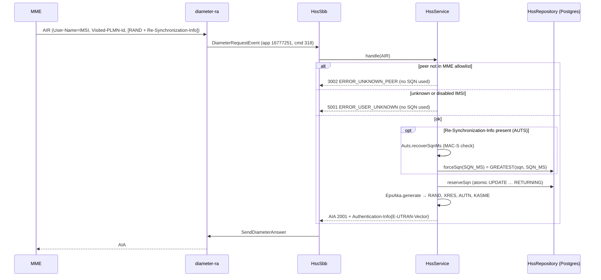
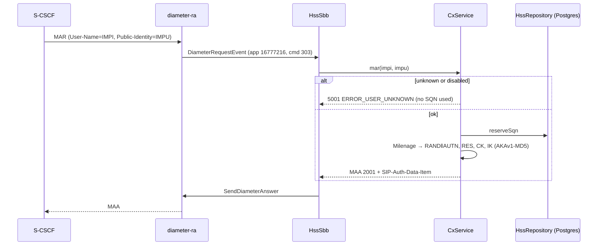
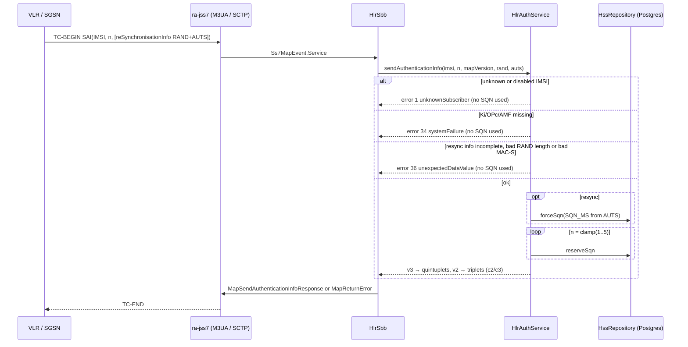
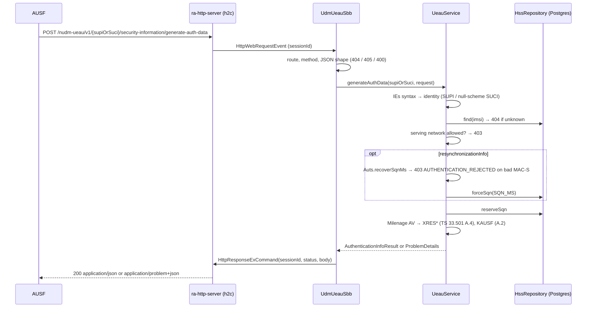

# Standalone HSS links — Diameter, SS7 MAP and HTTP/2 SBI on one AuC

**Status:** code + tests landed 2026-11-20 (HSS upgrade T1–T4, uncommitted when this page was written).
**Wire-proven: the SS7 face only** (MAP SAI over M3UA/SCTP, 2026-11-24, §8.3). Diameter and SBI are not. See [Proof level](#proof-level-honestly).
**Code:** `epc/epc-hss` — `app/HssMain`, `app/HssLinks`, `app/HssApp`, `app/HssBootstrap`,
`sbbs/HssSbb`, `sbbs/HlrSbb`, `sbbs/UdmUeauSbb`, `HssService`, `CxService`, `HlrAuthService`,
`UeauService`; `epc/epc-crypto` — `FiveGAka`, `Sqn`, `Auts`, `Milenage`.
**Related:** [`epc-p1.md`](epc-p1.md) (P1 gates, compose `epc-hss` service) ·
[`epc-hss-pcrf-full3gpp.md`](epc-hss-pcrf-full3gpp.md) (HSS data model, Cx, PCRF) ·
[`epc-slee.md`](epc-slee.md) (RA / SBB / Profile / CMP split).

## 1. Which HSS is this?

There are two ways to run the HSS code. Do not mix them up.

| Process | Entry point | Started by | Links |
|---|---|---|---|
| **Standalone HSS** (this page) | `et.epc.hss.app.HssMain` | nothing yet — no compose file or script starts it | Diameter + SS7 MAP + HTTP/2 SBI, each optional |
| **epc-host, role HSS** | Quarkus `EpcRuntime` (`EPC_ROLE_HSS`) | compose service `epc-hss` (see [`epc-p1.md`](epc-p1.md) §1) | Diameter S6a/Cx only, through `DiameterGatewaySbb` |

Both use the same `HssService`, `CxService` and the same Postgres `epc` schema. Only the
standalone process has the MAP and Nudm-UEAU faces.

## 2. What the standalone HSS exposes

One micro-jainslee container. Transport lives only in the RAs. Procedures live in the SBBs.
All four procedures below call **one AuC** (Milenage + TS 33.102 Annex C SQN) over **one SQN
space** per subscriber (`HssRepository.reserveSqn`).

```text
                    ┌────────────── epc-hss (MicroSleeContainer) ──────────────┐
 MME / S-CSCF ─Diameter─▶ diameter-ra    ─▶ HssSbb     S6a AIR/ULR/PUR (+CLR/IDR/DSR/RSR/NOR)
                    │                                   Cx  UAR/SAR/LIR/MAR (+Gx/Rx → 3002 here)
 VLR / SGSN ─MAP/M3UA/SCTP─▶ ra-jss7     ─▶ HlrSbb     MAP SendAuthenticationInfo v2/v3
 AUSF       ─HTTP/2 h2c──▶ ra-http-server ─▶ UdmUeauSbb Nudm-UEAU generate-auth-data
                    │      all call one AuC: Milenage + Annex C SQN, Postgres epc DB  │
                    └───────────────────────────────────────────────────────────────────┘
```

| Interface | Spec | RA (`@InjectRa` name) | Event | SBB | Service |
|---|---|---|---|---|---|
| S6a AIR / ULR / PUR | TS 29.272 | `diameter-ra` | `DiameterRequestEvent` (app 16777251) | `HssSbb` | `HssService` |
| Cx UAR / SAR / LIR / MAR | TS 29.228 / 29.229 | `diameter-ra` | `DiameterRequestEvent` (app 16777216) | `HssSbb` | `CxService` |
| MAP SendAuthenticationInfo v2 / v3 | TS 29.002 §8.5.2 | `ra-jss7` (M3UA over **SCTP only**) | `Ss7MapEvent.Service`, `Ss7MapEvent.Dialog` | `HlrSbb` | `HlrAuthService` |
| Nudm-UEAU generate-auth-data | TS 29.503 §5.4.2.2 | `http-server-ra` (HTTP/2 cleartext, prior knowledge, TS 29.500 §5.2.2; HTTP/1.1 also served) | `HttpWebRequestEvent` | `UdmUeauSbb` | `UeauService` |

Notes:
- `HssSbb` also routes Gx/Rx. `HssMain` passes no PCRF, so Gx/Rx get result code 3002.
- `HssApp` installs **only the faces whose link is enabled**. micro-jainslee checks every SBB's
  `@InjectRa` name at `start()`. A face without its RA aborts the start.
- None of the three SBB classes has a no-arg constructor. If one had, the container's APT
  auto-deploy would create a service-less instance that shadows the factory (pinned by `HssAppTest`).
- 5G: SUPI `imsi-…` or SUCI with the **null scheme only**. No SIDF, no SNPN.

## 3. Configuration

`HssLinks.load(Lookup.system())` reads each key from the `-D` system property first, then from
the environment. The environment name is the key upper-cased with `.` and `-` turned into `_`
(`hss.sbi.port` → `HSS_SBI_PORT`). Every link is **off** by default.

Malformed values are **refused, not defaulted**: a bad boolean, a bad number, a port outside
0..65535, a bad PLMN or a bad peer spec stops the start (exit 2).

### 3.1 Process keys

| Key | Env | Default | Meaning |
|---|---|---|---|
| `hss.lab` | `HSS_LAB` | `false` | Lab mode. Only lab mode accepts the public default KEK (WARN logged). |
| `hss.secret.kek-hex` | `HSS_SECRET_KEK_HEX` | unset | KEK that wraps Ki/OPc at rest. Unset, blank or the public `HssBootstrap.DEFAULT_KEK_HEX` → **refused** unless `hss.lab=true`. Never logged. |
| `hss.jdbc.url` | `HSS_JDBC_URL` | unset | `jdbc:postgresql:` on the `epc` DB → durable path + Flyway `db/migration-hss`. Unset → heap (R&D) path. H2/Derby/SQLite and `/elisa` are refused. |
| `hss.jdbc.user` | `HSS_JDBC_USER` | `epc` | DB user. |
| `hss.jdbc.password` | `HSS_JDBC_PASSWORD` | `epc` (lab default) | DB password. **Set it outside a lab.** |
| `epc.hss.mme.allowlist.enabled` | `EPC_HSS_MME_ALLOWLIST_ENABLED` | `false` | S6a AIR/ULR peer allowlist (Open5GS #4337). Parsed leniently (anything but `true` = off). |
| `epc.hss.mme.allowlist` | `EPC_HSS_MME_ALLOWLIST` | empty | Comma list of origin hosts / realms / PLMNs. |
| `hss.home-plmn` | `HSS_HOME_PLMN` | `00101` | Home PLMN as MCCMNC (5 or 6 digits, TS 23.003 §2.2). Used when an AIR has no Visited-PLMN-Id. Malformed → refused (exit 2). |

### 3.2 Diameter link (S6a / Cx)

| Key | Env | Default | Meaning |
|---|---|---|---|
| `hss.diameter.enabled` | `HSS_DIAMETER_ENABLED` | `false` | Bind `diameter-ra` and install `HssSbb`. |
| `hss.diameter.host` | `HSS_DIAMETER_HOST` | `127.0.0.1` | Listen address. |
| `hss.diameter.port` | `HSS_DIAMETER_PORT` | `3868` | Listen port. |
| `hss.diameter.origin-host` | `HSS_DIAMETER_ORIGIN_HOST` | `hss.epc.lab` | Origin-Host in CEA and answers. |
| `hss.diameter.origin-realm` | `HSS_DIAMETER_ORIGIN_REALM` | `epc.lab` | Origin-Realm. |
| `hss.diameter.transport` | `HSS_DIAMETER_TRANSPORT` | `tcp` | `tcp` or `sctp`. Anything else is refused. |
| `hss.diameter.peers` | `HSS_DIAMETER_PEERS` | empty | `DiameterRaConfig.parsePeers` spec: `host:port:role[:destHost[:destRealm[:app+app]]]`, entries separated by `;`, apps `s6a`, `cx`, `gx`, `rx`, `cc`. Empty = the RA's single legacy **server-role peer on 127.0.0.1**, so a remote MME/S-CSCF needs this key. |
| `hss.diameter.watchdog-ms` | `HSS_DIAMETER_WATCHDOG_MS` | `30000` | Tw-style silence limit for `peerReady`. `0` disables expiry. |

### 3.3 SS7 link (MAP SAI, HLR)

| Key | Env | Default | Meaning |
|---|---|---|---|
| `hss.ss7.enabled` | `HSS_SS7_ENABLED` | `false` | Bind `ra-jss7` (MAP on, CAP off) and install `HlrSbb`. |
| `hss.ss7.channel` | `HSS_SS7_CHANNEL` | absent = SCTP | **SCTP only.** Any other value (TCP, blank, typo) is refused at config time, **even when SS7 is off** (RFC 4666, repo rule). |
| `hss.ss7.host-ip` | `HSS_SS7_HOST_IP` | `127.0.0.1` | Local SCTP address. |
| `hss.ss7.host-port` | `HSS_SS7_HOST_PORT` | `2905` | Local SCTP port. |
| `hss.ss7.peer-ip` | `HSS_SS7_PEER_IP` | `127.0.0.1` | Peer (STP / SG) SCTP address. |
| `hss.ss7.peer-port` | `HSS_SS7_PEER_PORT` | `2906` | Peer SCTP port. |
| `hss.ss7.opc` | `HSS_SS7_OPC` | `1` | Own point code (0..0xFFFFFF). |
| `hss.ss7.dpc` | `HSS_SS7_DPC` | `2` | Peer point code. |
| `hss.ss7.local-ssn` | `HSS_SS7_LOCAL_SSN` | `6` | HLR SSN. |
| `hss.ss7.remote-ssn` | `HSS_SS7_REMOTE_SSN` | `7` | VLR SSN. |
| `hss.ss7.routing-context` | `HSS_SS7_ROUTING_CONTEXT` | `100` | M3UA routing context. |
| `hss.ss7.network-appearance` | `HSS_SS7_NETWORK_APPEARANCE` | `102` | M3UA network appearance. |
| `hss.ss7.invoke-timeout-ms` | `HSS_SS7_INVOKE_TIMEOUT_MS` | `30000` | TCAP invoke timer (TS 29.002 §17.6 timer *m*, 15–30 s). Keep it ≤ 60 s: jSS7 sets it before the dialog timeout (60 s default) and refuses a larger value at activation. |
| `hss.ss7.dialog-idle-timeout-ms` | `HSS_SS7_DIALOG_IDLE_TIMEOUT_MS` | `300000` | TCAP dialog idle timer. |

For a lab without the native F-Stack library, use kernel SCTP: `-Dsctp.backend=NETTY_KERNEL --add-modules jdk.sctp`
(`sctp-impl` 2.27.34 is pinned in the epc-hss pom for that backend).
jSS7 writes its management XML files (`epc-hss-ss7-*.xml`) into the **working directory** and reloads them
at the next start: run the HSS from its own directory, never from the repo.
Never TCP. Check endpoints in `/proc/net/sctp/eps`, not `ss -tlnp`.

### 3.4 SBI link (Nudm-UEAU)

| Key | Env | Default | Meaning |
|---|---|---|---|
| `hss.sbi.enabled` | `HSS_SBI_ENABLED` | `false` | Bind `ra-http-server` and install `UdmUeauSbb`. |
| `hss.sbi.host` | `HSS_SBI_HOST` | `127.0.0.1` | Listen address. |
| `hss.sbi.port` | `HSS_SBI_PORT` | `7777` | Listen port (`0` = ephemeral). |
| `hss.sbi.response-timeout-ms` | `HSS_SBI_RESPONSE_TIMEOUT_MS` | `5000` | RA deadline; an unanswered request gets **504**. `0` **disables** the deadline (the RA's own default is 300 s; `HssLinks` sets 5 s). |
| `hss.sbi.allowed-serving-plmns` | `HSS_SBI_ALLOWED_SERVING_PLMNS` | empty | Serving PLMNs accepted besides each subscriber's home PLMN. CSV of `MCCMNC` or `MCC-MNC` (`00101,452-04`). |

### 3.5 Run example (not executed as part of this change)

There is no dist packaging or exec plugin for `HssMain` yet. A lab run from the source tree,
with JDK 25:

```bash
cd epc
export JAVA_HOME=$HOME/.local/share/mise/installs/java/zulu-25 PATH=$JAVA_HOME/bin:$PATH
MVN="mvn -o -q -Daether.enhancedLocalRepository.trackingFilename=_untracked_"
$MVN -pl epc-hss -am install -DskipTests
$MVN -pl epc-hss dependency:build-classpath -Dmdep.outputFile=target/hss.cp

# Lab: heap store, public KEK accepted, Diameter + SBI on loopback, SS7 off.
java -cp epc-hss/target/classes:$(cat epc-hss/target/hss.cp) \
  -Dhss.lab=true \
  -Dhss.diameter.enabled=true \
  -Dhss.diameter.peers='127.0.0.1:0:server:mme.epc.lab:epc.lab:s6a+cx' \
  -Dhss.sbi.enabled=true -Dhss.sbi.allowed-serving-plmns=00101 \
  et.epc.hss.app.HssMain
```

Outside a lab: drop `hss.lab`, set `HSS_SECRET_KEK_HEX`, `HSS_JDBC_URL`, `HSS_JDBC_PASSWORD`
from the environment (never on the command line), and set `hss.diameter.peers` to the real peers.

### 3.6 Start-up and status line

Order: load config → KEK check → wire services (heap or Postgres + Flyway) → install the
enabled faces → register the RAs → `container.start()` → `Bound.verify()`.

- Each RA is wrapped in an `ActivationProbe`. The container logs and swallows an RA activation
  failure, and `DiameterResourceAdaptor.isActive()` turns true before its transport starts, so
  the probe is the proof.
- An enabled link that did not come up → the container stops, `HssMain` exits **2**. A refused
  config or KEK also exits 2.
- The status line (`epc-hss status diameter=bound(tcp h:p, peerReady=…) ss7=active(sctp …,
  m3uaRouteReady=…) sbi=listening h2c h:p`) is printed at boot, then re-read every 30 s and printed
  again **only when it changes** (`HssApp.StatusMonitor`, own daemon thread, not an SBB thread).
  Bound, active and listening are **local** truth; `peerReady` / `m3uaRouteReady` are peer truth.
- Diameter enabled on a non-loopback host with an empty `hss.diameter.peers` → WARN at boot: only
  the loopback server peer exists, a remote MME / S-CSCF cannot connect.

## 4. Sequence diagrams

### 4.1 S6a AIR (incl. resync)



ULR stores the serving MME and clears `purged`; PUR sets `purged`. Neither touches the SQN.

### 4.2 Cx MAR



Cx MAR has **no resync path** today: a MAR that carries AUTS in SIP-Authorization is not
re-synchronised. UAR, SAR and LIR never touch the SQN.

### 4.3 MAP SendAuthenticationInfo (incl. resync)



### 4.4 Nudm-UEAU generate-auth-data (incl. resync)



## 5. State transitions

### 5.1 SQN (TS 33.102 Annex C)

- SQN (48 bits) = SEQ (43 bits) ‖ IND (5 bits). `Sqn.next(sqn)` = SEQ + 1 and IND + 1 (mod 32).
  Same parameters as Open5GS / free5gc.
- The SQN lives **only** in Postgres (`epc_subscriber.sqn`), or in the heap row in R&D mode.
  Never cached, never shared between vectors.
- `reserveSqn` = one atomic `UPDATE … SET sqn = <next> … RETURNING sqn`. Two vectors never get
  the same SQN, even across nodes and across interfaces.
- One SQN space per subscriber for S6a, Cx, MAP and Nudm-UEAU. The cyclic IND lets the USIM
  accept vectors that different serving nodes use out of order.

```text
 SQN_HE = s ──reserveSqn──▶ SQN_HE = next(s)  (vector built with next(s))
 SQN_HE = s ──resync(AUTS → SQN_MS)──▶ SQN_HE = max(s, SQN_MS) ──reserveSqn──▶ next(max(s, SQN_MS))
```

### 5.2 Resync via AUTS (TS 33.102 §6.3.5)

1. The UE rejects AUTN (SQN out of range) and sends AUTS. The serving node passes RAND + AUTS.
2. `Auts.recoverSqnMs` computes SQN_MS = (AUTS[0..5] ⊕ AK*) and checks MAC-S (AMF* = 0000).
3. MAC-S fails → no change, the request is refused (see the table below).
4. MAC-S ok → `forceSqn(SQN_MS)`: `SQN_HE = GREATEST(SQN_HE, SQN_MS)`. The HE never goes
   backwards. Then fresh vectors are reserved from there.

Not implemented: the Δ window check ("reject AUTS outside Δ") listed in
[`epc-hss-pcrf-full3gpp.md`](epc-hss-pcrf-full3gpp.md) Phase A.3.

| Interface | Resync | Bad MAC-S / bad AUTS |
|---|---|---|
| S6a AIR | yes (Re-Synchronization-Info) | **exception escapes `HssSbb.onEvent`: no AIA is sent** (see risks) |
| Cx MAR | **no** | n/a |
| MAP SAI | yes (reSynchronisationInfo) | MAP error 36 unexpectedDataValue |
| Nudm-UEAU | yes (resynchronizationInfo) | 403 `AUTHENTICATION_REJECTED` |

### 5.3 Requests that never consume an SQN

Every refusal happens **before** `reserveSqn`:

- S6a AIR: missing/malformed User-Name, peer not allowed (3002), unknown or disabled IMSI (5001).
- Cx MAR: unknown or disabled identity (5001), no secret store (5003 ERROR_AUTHORIZATION_REJECTED).
- MAP SAI: unknown subscriber (1), missing secrets (34), bad resync info or MAC-S (36).
- Nudm-UEAU: every 4xx/5xx in [§7](#7-nudm-ueau-error-mapping).
- ULR, PUR, CLR, IDR, DSR, UAR, SAR, LIR: never.

Other state: `HssSbb` keeps Session-Id and Application-Id in CMP for the request. `HlrSbb` and
`UdmUeauSbb` are stateless per request (the HTTP `sessionId` is only echoed back).

## 6. Timeout strategy

| Link | Timer | Where | Default | Behaviour |
|---|---|---|---|---|
| Diameter | Watchdog (Tw-style silence limit) | `diameter-ra` `DiameterPeerTracker`, `hss.diameter.watchdog-ms` | 30 s | No CE/DW/app traffic for that long → `peerReady=false`. Inbound DWR is answered with DWA by the RA. `0` = no expiry. |
| Diameter | Tx (request timer) and DWR origination | Corsac stack inside `diameter-ra` | stack default | Not configurable from `HssLinks`. It only matters for requests the HSS sends (CLR/IDR/DSR); the HSS answers inbound requests and runs no timer on them. Not verified here. |
| SS7 | TCAP invoke timer | `ra-jss7` TCAP, `hss.ss7.invoke-timeout-ms` | 30 s | Guards invokes the HSS sends. The HLR only answers, so the VLR's own timer is the one that fires if the HSS stays silent. |
| SS7 | TCAP dialog idle timer | `ra-jss7` TCAP, `hss.ss7.dialog-idle-timeout-ms` | 300 s | Releases a dialog that the HSS never closed (e.g. the SBB threw). |
| SBI | Response deadline | `ra-http-server`, `hss.sbi.response-timeout-ms` | 5 s | No `HttpResponseExCommand` in time → the RA answers **504** and frees the stream. `0` disables it. |

The SBI deadline is only a last resort. `UdmUeauSbb.onEvent` **never throws**: it catches
`RuntimeException | LinkageError` and answers 500 `SYSTEM_FAILURE`. A 504 therefore means the
command port was missing or the event never reached the SBB.

`HssSbb` and `HlrSbb` do **not** have that guard. An exception (a JDBC error, a bad AUTS on S6a)
leaves the peer waiting for its own timer. See [§9](#9-known-risks).

## 7. Nudm-UEAU error mapping

Errors are `application/problem+json` with `title`, `status`, `detail` and `cause`. Causes
follow the cached TS 29.503 v16.5.0 and TS 29.500 Table 5.2.7.2-1.

| Case | Status | Cause | Set by |
|---|---|---|---|
| URI is not `/nudm-ueau/v1/{supiOrSuci}/security-information/generate-auth-data` | 404 | `RESOURCE_URI_STRUCTURE_NOT_FOUND` | SBB |
| `{supiOrSuci}` has a bad `%` escape | 404 | `RESOURCE_URI_STRUCTURE_NOT_FOUND` | SBB |
| Method other than POST | 405 + `Allow: POST` | none (TS 29.500 defines none for 405) | SBB |
| Body is not a JSON object | 400 | `INVALID_MSG_FORMAT` | SBB |
| `servingNetworkName` / `ausfInstanceId` not a string | 400 | `MANDATORY_IE_INCORRECT` | SBB |
| `resynchronizationInfo` not an object of strings | 400 | `OPTIONAL_IE_INCORRECT` | SBB |
| Body missing, `servingNetworkName` or `ausfInstanceId` missing | 400 | `MANDATORY_IE_MISSING` | service |
| `servingNetworkName` malformed, `ausfInstanceId` not a uuid | 400 | `MANDATORY_IE_INCORRECT` | service |
| `rand` not 16 octets hex or `auts` not 14 octets hex | 400 | `OPTIONAL_IE_INCORRECT` | service |
| Non-IMSI SUPI, malformed SUCI, non-IMSI SUCI type, unknown or disabled subscriber | 404 | `USER_NOT_FOUND` | service |
| SUCI protection scheme other than null | 501 | `UNSUPPORTED_PROTECTION_SCHEME` | service |
| Null scheme with home network key id ≠ 0 | 403 | `INVALID_HN_PUBLIC_KEY_IDENTIFIER` | service |
| Null-scheme MSIN not digits or too long | 403 | `INVALID_SCHEME_OUTPUT` | service |
| Serving network not home PLMN and not in `hss.sbi.allowed-serving-plmns`, or SNPN form | 403 | `AUTHENTICATION_REJECTED` (`SERVING_NETWORK_NOT_AUTHORIZED` was removed by CR 0450, v16.4.0) | service |
| AUTS MAC-S fails | 403 | `AUTHENTICATION_REJECTED` | service |
| Ki / OPc / AMF unavailable | 500 | `SYSTEM_FAILURE` | service |
| Any other exception or `LinkageError` in the SBB | 500 | `SYSTEM_FAILURE` | SBB |
| SBB never answers | 504 | (RA body `{"error":…}`) | RA |
| Success | 200 | `authType=5G_AKA`, `avType=5G_HE_AKA`, `rand`, `autn`, `xresStar`, `kausf`, `supi` | service |

Secrets: the SBB never logs the event or a body (a 200 carries XRES* and KAUSF).
`Av5GHeAka.toString()` redacts XRES* and KAUSF.

## 8. Proof level, honestly

### 8.0 Answers on every path (2026-11-24)

- `HssSbb`: any exception while handling S6a / Cx / Gx / Rx → **5012** `DIAMETER_UNABLE_TO_COMPLY`
  on the request's hop-by-hop / end-to-end ids (RFC 6733 §7.1.5). `HlrSbb`: → MAP `systemFailure`
  on the dialog. One WARN with the last 4 IMSI digits; never keys or vectors.
- Bad AUTS (MAC-S fails, wrong length, no RAND) → Experimental-Result **4181**
  `DIAMETER_AUTHENTICATION_DATA_UNAVAILABLE` on AIR (TS 29.272 §5.2.3.1.3) and MAR. A repository
  failure during resync is not "bad AUTS": it goes to the 5012 path.
- AIR Re-Synchronization-Info is **RAND ‖ AUTS (30 octets)** (TS 29.272 §7.3.15); a bare 14-octet AUTS
  with a separate RAND AVP is still accepted.
- MAR resync: SIP-Authorization = RAND ‖ AUTS in SIP-Auth-Data-Item (TS 29.229) → SQN_MS adopted.
- AIR Number-Of-Requested-Vectors / MAR SIP-Number-Auth-Items honoured, 1..5, one SQN each.
- PUR from a peer outside the MME allowlist → refused, no state change.

### 8.1 Unit / integration proven (`mvn test`, 2026-11-20; epc-hss 217 on 2026-11-24)

| Test | Count | Proves |
|---|---|---|
| `FiveGAkaTest` (epc-crypto) | 20 | KDF layout, KAUSF, XRES* low half, HXRES*, SN-name check; cross-check against raw `javax.crypto.Mac` |
| `SqnAnnexCTest`, `MilenageTs35208Test`, `MilenageTest` (epc-crypto) | 4 / 2 / 42 | Annex C SEQ/IND, Milenage on TS 35.208 sets |
| `UeauServiceTest` | 14 | Nudm-UEAU procedure, causes, one SQN space shared with MAP, resync good/bad, no SQN on refusal |
| `UdmUeauSbbTest` | 12 | routing, 404/405/400, problem+json, 500 guard |
| `UdmUeauHttp2Test` | 2 | **HTTP/2 h2c prior knowledge** on a real `ra-http-server` socket (loopback): `version()==HTTP_2`, 200 `5G_HE_AKA`, 404 on the same connection; HTTP/1.1 still served |
| `HlrAuthServiceTest`, `HlrSbbTest` | 5 / 2 | SAI v3 quintuplets with distinct SQNs, v2 triplets, clamp 1..5, resync, unknown subscriber, answer on the request dialog (fake command port) |
| `HssServiceResyncTest`, `HssServiceTest`, `HssServiceSecurityTest`, `HssServiceEdgeTest`, `HssSbbTest` | 2 / 6 / 11 / 10 / 11 | S6a AIR/ULR/PUR, allowlist, AIR resync with a good AUTS |
| `CxServiceTest`, `CxServiceMarDigestTest`, `CxStructuredAvpTest` | 11 / 2 / 7 | Cx UAR/SAR/LIR/MAR |
| `HssLinksTest` | 16 | config parsing, env names, malformed values refused, SCTP-only refusal, KEK refusal, SBI listen + serve on loopback, port in use fails the start, Diameter TCP bind on loopback with `peerReady=false`, SS7 link not active fails loudly |
| `HssAppTest`, `HssBootstrapTest` | 5 / 4 | face install, strict `@InjectRa` abort, APT auto-deploy trap, factory instances answer AIR / MAP SAI / Nudm-UEAU |

Full `epc` reactor: see `docs/status/PENDING-ISSUES.md` § HSS links for the per-module counts.

### 8.2 NOT wire-proven

- **No real MME or S-CSCF** has sent AIR/MAR to the standalone HSS. Diameter was only bound on
  loopback; no CER/CEA with a peer in a test.
- **No VLR, SGSN or STP.** The SS7 link has **never run on a live SCTP association**. No M3UA
  ASP-ACTIVE, no TCAP dialog on the wire. `HlrSbb` was only driven through a fake command port.
- **No AUSF.** The SBI was only called by an in-test Vert.x client.
- **No 3GPP-published 5G AKA vector.** KAUSF / XRES* / HXRES* are pinned with self-derived
  values (TS 35.208 Test Set 1 + Python `hmac`). A real UE or a published KAT is still needed.
- `HssMain` has not been packaged or run as a process; no dist exists for it.

## 9. Known risks

| # | Risk | Effect | Fix direction |
|---|---|---|---|
| R1 | Blocking JDBC on the SBB event thread (`JdbcHssRepository`, `reserveSqn`) | A slow DB stalls every face | Move DB work off the event thread or bound it |
| R2 | `HssSbb.onEvent` and `HlrSbb.onEvent` have no catch-all. A JDBC error, or an S6a AIR with a bad AUTS / missing RAND (`Auts.recoverSqnMs` throws), escapes | No AIA / no MAP answer; the peer waits for its own timer | Catch and answer (S6a: e.g. AUTHENTICATION_DATA_UNAVAILABLE; MAP: systemFailure), like `UdmUeauSbb` |
| R3 | Status line printed once at boot; `peerReady` / `m3uaRouteReady` read `false` then | No live link truth after boot | Periodic or on-change status / admin endpoint |
| R4 | Diameter with empty `hss.diameter.peers` = one server-role peer on 127.0.0.1 | A remote MME/S-CSCF cannot connect | Always set `hss.diameter.peers` outside a loopback lab |
| R5 | Home PLMN hard-coded to 001/01 in `HssMain` | An AIR without a valid Visited-PLMN-Id gets a KASME bound to 001/01, and a ULA without one echoes 001/01. (Nudm-UEAU uses each subscriber's own `homePlmn`.) | Add a config key |
| R6 | `hss.jdbc.password` defaults to `epc` | Weak lab credential if forgotten | Require it when `hss.jdbc.url` is set and not lab |
| R7 | epc-host (the compose `epc-hss` service) still defaults `epc.hss.secret.kek-hex` to the public KEK: `epc/epc-host/src/main/resources/application.properties`, `dist/epc/configs/application.properties`, `EpcRuntime.java` | Ki/OPc wrapped with a key published in the tree. The new `hss.lab` refusal covers `HssMain` only | Same refusal rule in epc-host |
| R8 | Jackson BOM: jSS7 drags `jackson-core` 2.15.2; Vert.x 4.5.36 needs 2.21.x | `NoSuchMethodError` in Vert.x JSON at runtime | Import `jackson-bom` 2.21.8 in **every** module that puts Vert.x next to `ra-jss7` (done in epc-hss) |
| R9 | SBBs registered through `registerSbbType` must not have a no-arg constructor | APT auto-deploy shadows the factory with a service-less instance | Keep the rule; `HssAppTest` pins it |
| R10 | Cx MAR has no AUTS resync; no Δ window on resync; AIR returns one vector (ignores Number-Of-Requested-Vectors) | IMS resync fails; behaviour differs from the [`epc-hss-pcrf-full3gpp.md`](epc-hss-pcrf-full3gpp.md) Phase A.3 plan | Implement per TS 29.228 / TS 33.102 |
| R11 | PUR has no peer allowlist check | Any Diameter peer can mark a subscriber purged | Apply `MmeAllowlist` to PUR too |
| R12 | Elisa `HssLiteService` (`AkaMd5.generate`) is a second AuC with its own SQN | Two SQN spaces if both serve the same subscriber | Owner decision pending |

## 10. Consistency with the other EPC docs

- [`epc-p1.md`](epc-p1.md) and [`epc.md`](epc.md) describe the compose `epc-hss` service as
  epc-host with `EPC_ROLE_HSS`. That is still true. The standalone `HssMain` is a separate
  process and is not in compose.
- [`epc-hss-pcrf-full3gpp.md`](epc-hss-pcrf-full3gpp.md) says Phases A–D are implemented. Phase
  A.3 ("honor Number-Of-Requested-Vectors (1–5) … resync window bounds (reject AUTS outside Δ)")
  is **not** in `HssService`: AIR reserves exactly one SQN and `forceSqn` has no Δ check. This
  page reflects the code.
- The Infinispan `CachingHssRepository` from that plan is wired in epc-host only. `HssMain`
  uses `JdbcHssRepository` directly, with no cache. The rule "SQN and secrets never cached"
  holds in both.

### 8.3 Wire proof — HLR face, MAP SAI over M3UA / SCTP (2026-11-24)

Standalone `HssMain` (SS7 face only, Postgres DB `epc_hlr` with the lab subscriber
`001010000000009`) ↔ lab VLR `loadtest/ss7/VlrSai.java` (jSS7 MAP client, SCTP server, M3UA IPSP
server), kernel SCTP on loopback, OPC 1 / DPC 2, SSN 6 ↔ 7.

```bash
# HSS (own working directory: jSS7 writes its XML state there)
HSS_JDBC_URL=jdbc:postgresql://<postgres-epc>:5432/epc_hlr HSS_JDBC_PASSWORD=… \
java --add-modules jdk.sctp -Dsctp.backend=NETTY_KERNEL -cp "$CP" -Dhss.lab=true \
  -Dhss.ss7.enabled=true et.epc.hss.app.HssMain
# VLR: local, HSS, own PC, HLR PC, IMSI, vectors
java --add-modules jdk.sctp -Dsctp.backend=NETTY_KERNEL -cp "$CP" loadtest/ss7/VlrSai.java \
  127.0.0.1:2906 127.0.0.1:2905 2 1 001010000000009 2
```

| Proof | Result |
|---|---|
| SCTP INIT/INIT-ACK, M3UA ASPUP/ASPAC + NTFY (both ways) | pcap `loadtest/pcaps/hss/hlr-sai-sctp.pcap` |
| `invoke sendAuthenticationInfo` → `returnResultLast sendAuthenticationInfo` (TCAP Begin / End) | same pcap, frames 34 / 36 |
| 2 quintuplets, AMF `3830` in AUTN, SQN 561 → 594 (Annex C) | VLR output |
| MAC-A and XRES of both vectors recomputed with Milenage from the stored Ki/OPc | **PASS / PASS** (independent check, keys not printed) |
| Unknown IMSI (heap store) → MAP `unknownSubscriber`, dialog closed | `loadtest/pcaps/hss/hlr-sai-heap.pcap` |

Fixed to get there (none of it showed in unit tests):

1. `ra-jss7` flat config → SCCP rule without GT type / plan → jSS7 9.2.11-j25 refused it
   (`unsupported gtType 'null'`, then an NPE): every flat-config RA failed activation (micro-jainslee `1aa56fae5`).
2. `ra-jss7` never declared the peer SSN (`remoteSsn`) as an SCCP remote subsystem → the HLR's answer
   to SSN 7 was dropped ("no Remote SubSystem = 7") (same commit).
3. epc-hss resolved `sctp-impl` 1.8.15 through jdiameter → no Netty SCTP backend → pinned 2.27.34.
4. Default TCAP invoke timeout 120 s > jSS7's 60 s dialog default → activation refused → 30 s.
5. `ra-jss7` had no SCCP long-message rule → UDT only → a SAI answer with 3 quintuplets was dropped
   ("message is too long") → XUDT enabled towards the peer DPC (micro-jainslee `541151e8f`).
   Re-proven with the pom-resolved classpath: 3 quintuplets in two XUDT segments, all three MAC-A /
   XRES PASS (`loadtest/pcaps/hss/hlr-sai-xudt-3vectors.pcap`).

Not proven yet: Diameter S6a/Cx against this process (the CSCF chain runs against epc-host's HSS),
SBI against a real AUSF, SS7 through a real STP / SG.

