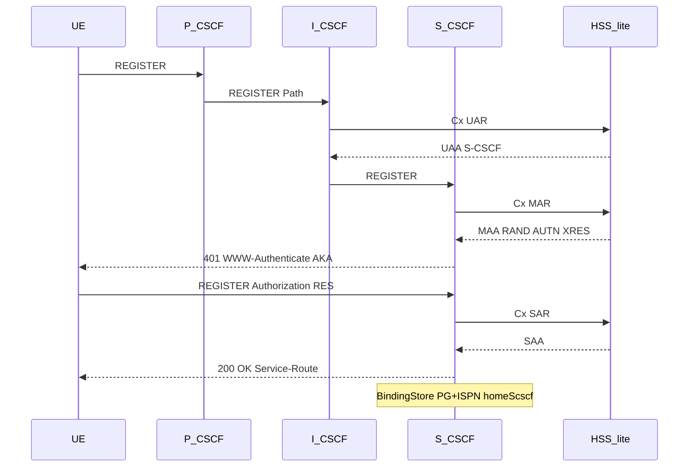
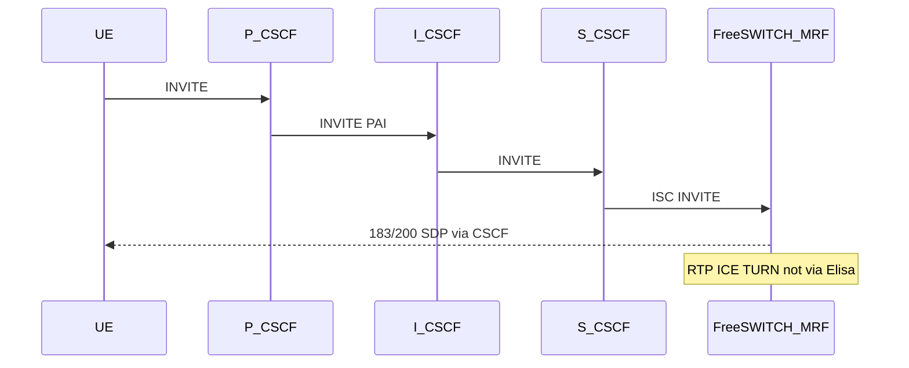
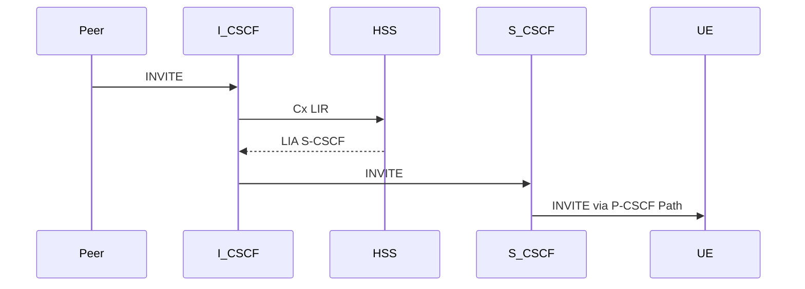

# Elisa IMS Core (grill I1–I8)

Lab IMS Core in one Quarkus/micro-jainslee process. Roles enabled per deploy via flags. FreeSWITCH = MRF/AS media only. Elisa is **not** an SBC (no RTP).

## Locks

| Id | Decision |
|----|----------|
| **I1** | Elisa = lab IMS Core |
| **I2** | Combined P/I/S-CSCF + HSS-lite in one tree; `sf.ims.role.*` feature flags |
| **I3** | Auth = IMS AKA + Diameter Cx |
| **I4** | HSS-lite in-tree when `sf.ims.role.hss=true`; else Cx client to external/sim HSS |
| **I5** | Bare FreeSWITCH as MRF/AS (ISC + ESL); FreePBX GUI out of Phase 1 |
| **I6** | No RTP through Elisa |
| **I7** | N–N: C1 Infinispan + C2 VIP + C3 FS pair; registration home S-CSCF sticky |
| **I8** | JDK 25, Log4j2, OTA dist, HTMX admin |

## Role flags

```properties
sf.ims.role.pcscf=true
sf.ims.role.icscf=true
sf.ims.role.scscf=true
sf.ims.role.hss=true
```

All `true` = combined lab node. Split deploy = enable subset — **one image, many services** + N–N: [`multi-service-deploy.md`](multi-service-deploy.md). Feature inventory: [`ims-feature-map.md`](ims-feature-map.md).

## Spec anchors

- TS 23.228 — NF / ISC
- TS 24.229 — Gm/Mw REGISTER/INVITE, Path / Service-Route
- TS 29.228 / 29.229 — Cx UAR/MAR/SAR/LIR
- TS 33.203 — IMS AKA
- RFC 3261 — transaction/dialog SM (`ra-sip-servlet`)
- 5G access (context only) — TS 23.501 / 23.502 (AMF/SMF/UPF); Elisa does **not** implement 5GC

---

## 5G → CSCF boundary (design)

**5GC (AMF/SMF/UPF)** owns registration on the radio/core control plane and the PDU session (including an IMS APN/DNN). **Voice signaling is still IMS SIP** on the **Gm** interface toward the **P-CSCF**.

When a VoNR/VoLTE-style call is “pushed to CSCF”, the SIP REGISTER/INVITE has already arrived at the Elisa SIP VIP / P-CSCF. Elisa does **not** replace AMF/SMF or terminate N1/N2.

```text
UE ──N1/N2──► AMF ──► SMF/UPF          (5GC: attach, PDU / IMS DNN)
 │
 └──Gm SIP──► P-CSCF (Elisa) ──Mw──► I/S-CSCF ──ISC──► FreeSWITCH (MRF/AS)
                                    Cx ↕ HSS-lite
              RTP / ICE / TURN ◄──────────────────────► FreeSWITCH / coturn
```

| Plane | Owner | Elisa? |
|-------|--------|--------|
| 5GC N1/N2/N4, PDU | AMF/SMF/UPF (external / future 5GC stack) | **No** |
| SIP Gm / Mw / ISC | CSCF SBBs + `ra-sip-servlet` | **Yes** |
| Cx | `CxClient` / `HssLiteService` | **Yes** (lab) |
| Dialplan / directory | FreeSWITCH + `xml_curl` → Elisa HTTP | FS + Elisa REST |
| ESL control | `ra-freeswitch` / ESL client | **Yes** (control only) |
| RTP / ICE / TURN | FreeSWITCH + coturn (`rtp_redirect`) | **No RTP** |

**Ingress (locked):** nginx **http** → admin `:8088`; nginx **stream** L4 VIP → SIP `:5060` with src-IP affinity — [`nginx-ingress.md`](nginx-ingress.md) (N1–N8) · [`cluster-c2-vip-affinity.md`](cluster-c2-vip-affinity.md). Nginx is **not** a P-CSCF and does **not** carry RTP.

---

## App ownership (what handles the call)

| Step | Component | Action |
|------|-----------|--------|
| Gm REGISTER / INVITE | `PcscfProxySbb` | Path / PAI / Route toward I; co-located: do not double-answer |
| Cx UAR / LIR | `IcscfRoutingSbb` + `CxClient` | Select home S-CSCF; 403/404/503 as designed |
| AKA REGISTER | `ScscfRegisterSbb` | MAR → cache XRES (`rememberChallenge`) → 401; RES verify → SAR → `BindingStore` |
| Session INVITE | `ScscfInviteSbb` | MO→ISC AS / MT→contact; CMP checkpoint; forward 1xx/2xx |
| iFC-lite | `IscAsRouter` | `shouldInvokeAs` → FS trunk URI; skip → Request-URI |
| AS notify (lab) | `IscThirdPartyRegister` | ESL soft notify after REGISTER 200 |
| xml_curl | `FsXmlCurlResource` | directory / dialplan from IMS profile + PG |
| CHANNEL_* | `CallSessionSbb` + ESL | Correlate `fs_uuid` ↔ SIP Call-ID |
| Media policy | ICE/TURN knobs | Reject non-relay when `rtp_redirect` — [`media-ice-turn.md`](media-ice-turn.md) |

**S-CSCF INVITE target (lab):**

1. `BindingStore.findLive(to)` present → **MT** → registered contact  
2. Else MO: `IscAsRouter.shouldInvokeAs(iFC)` → FreeSWITCH `asUri()`  
3. Else iFC skip → Request-URI (`to`), do **not** force AS  

---

## REGISTER (AKA) — combined node + FreeSWITCH notify

```mermaid
sequenceDiagram
  autonumber
  participant UE as UE_5G
  participant P as PcscfProxySbb
  participant I as IcscfRoutingSbb
  participant S as ScscfRegisterSbb
  participant H as HssLite_Cx
  participant B as BindingStore
  participant FS as FreeSWITCH

  UE->>P: REGISTER (Gm)
  Note over P: co-located: Path observed; S owns AKA
  P->>I: Mw REGISTER + Path
  I->>H: Cx UAR
  H-->>I: UAA (S-CSCF)
  I->>S: REGISTER
  S->>H: Cx MAR
  H-->>S: MAA RAND||AUTN + XRES
  Note over S: rememberChallenge(callId/IMPI, XRES)
  S-->>UE: 401 WWW-Authenticate AKAv1-MD5
  UE->>S: REGISTER Authorization RES
  S->>S: verifyRes
  S->>H: Cx SAR
  S->>B: upsert IMPU contact Path homeScscf
  S-->>UE: 200 Service-Route + Path
  opt ISC third-party notify (lab)
    S->>FS: ESL xml_flush / sofia rescan
  end
```

Compact (role-level):



---

## MO INVITE — full FreeSWITCH (ISC + xml_curl + ESL + RTP)

```mermaid
sequenceDiagram
  autonumber
  participant UE as UE_5G
  participant P as P_CSCF
  participant I as I_CSCF
  participant S as ScscfInviteSbb
  participant CMP as DialogCmp_ISPN_PG
  participant FS as FreeSWITCH_Sofia
  participant XC as xml_curl_Elisa
  participant ESL as ESL_control
  participant TURN as coturn

  UE->>P: INVITE + SDP (ICE) Gm
  P->>P: stamp P-Asserted-Identity
  Note over P: P-only Route→I; co-located S handles session
  P->>I: INVITE + PAI
  I->>S: INVITE
  S->>S: MO vs MT (binding / iFC)
  S->>CMP: CMP save INVITE trunkUri callId
  S->>FS: ISC INVITE + Route + X-Elisa-Sip-Call-Id + SDP
  FS->>XC: POST /fs/xml directory|dialplan
  XC-->>FS: dialplan bypass_media=false ICE
  FS-->>S: 100 / 183 + SDP
  S->>CMP: state EARLY
  S-->>UE: 183 via CSCF
  Note over UE,TURN: RTP UE ↔ TURN ↔ FS — not via Elisa
  UE->>TURN: RTP relay
  TURN->>FS: RTP
  FS-->>S: 200 OK + SDP
  S->>CMP: state CONFIRMED
  S-->>UE: 200 OK
  UE->>S: ACK
  S->>FS: ACK
  FS->>ESL: CHANNEL_CREATE / ANSWER
  ESL->>S: FsChannelEvent → CallSession correlate
  UE->>S: BYE
  S->>FS: BYE
  S->>CMP: remove TERMINATED
  S-->>UE: 200
  FS->>ESL: CHANNEL_HANGUP
```

Compact:



---

## MT INVITE — peer → home S-CSCF → UE (optional MRF)

```mermaid
sequenceDiagram
  autonumber
  participant Peer as Peer_or_MGCF
  participant I as IcscfRoutingSbb
  participant H as HSS_Cx
  participant S as ScscfInviteSbb
  participant P as P_CSCF_Path
  participant UE as UE_5G
  participant FS as FreeSWITCH

  Peer->>I: INVITE (Request-URI = IMPU)
  I->>H: Cx LIR
  H-->>I: LIA home S-CSCF
  I->>S: INVITE
  S->>S: findLive(IMPU) → contact + Path
  opt MMTel / MRF before UE
    S->>FS: ISC INVITE (iFC)
    FS-->>S: 183/200
  end
  S->>P: INVITE (Route Path)
  P->>UE: INVITE Gm
  UE-->>S: 180/200 + SDP
  Note over UE,FS: RTP via TURN/FS when rtp_redirect; else per SDP
```

Compact:



---

## Cluster

- Registration: IMPU → `home_scscf_node` in `ims_binding`
- Dialog: Infinispan checkpoint on home S-CSCF ([`cmp-recovery.md`](cmp-recovery.md))
- FS: `sf_fs_pair` affinity to owning S-CSCF node ([`cluster-c2-vip-affinity.md`](cluster-c2-vip-affinity.md))

## Non-goals

- SBC / RTP relay / FreePBX as signaling
- PCRF Rx/N5, MGCF/BGCF in early phases
- Implementing AMF/SMF/UPF inside Elisa
- VoLTE/VoNR certification claims without interconnect tests
- nginx as SIP application / RTP proxy

## Related

- Spec header preserve list: [`3gpp-sip-ims.md`](3gpp-sip-ims.md)
- Architecture overview: [`architecture.md`](architecture.md)
- Media: [`media-ice-turn.md`](media-ice-turn.md)
- ESL RA: [`ra-freeswitch.md`](ra-freeswitch.md)
- FS control / xml_curl: [`fs-control.md`](fs-control.md)
- User profile + FS call correlate: [`user-profile.md`](user-profile.md)
- JAIN SLEE ProfileFacility: [`jainslee-profile.md`](jainslee-profile.md)
