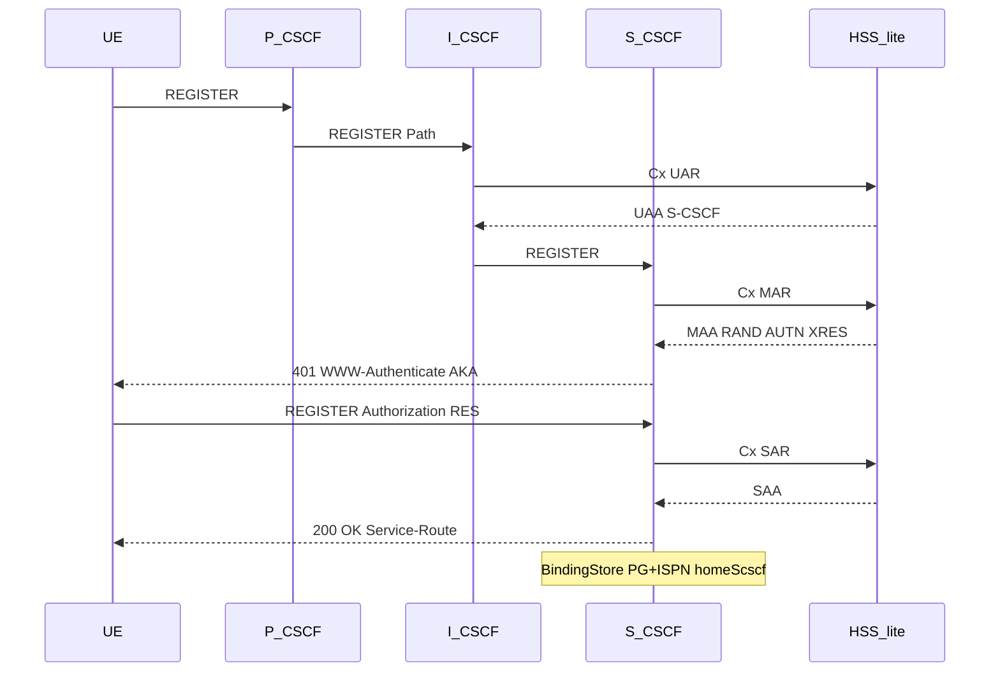
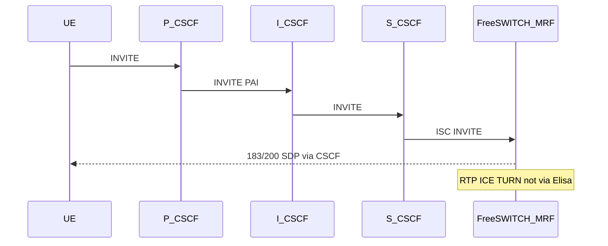
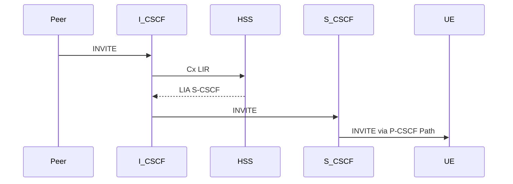

# Elisa IMS Core (grill I1–I8)

Lab IMS Core in one Quarkus/micro-jainslee process. Roles enabled per deploy via flags. FreeSWITCH = MRF/AS media only. Elisa is **not** an SBC (no RTP).

## Locks

| Id | Decision |
|----|----------|
| **I1** | Elisa = lab IMS Core |
| **I2** | Combined P/I/S-CSCF + HSS-lite in one tree; `sf.ims.role.*` feature flags |
| **I3** | Auth = IMS AKA + Diameter Cx |
| **I4** | HSS-lite in-tree when `sf.ims.role.hss=true`; else Cx client to external/sim HSS |
| **I5** | Bare FreeSWITCH as MRF/AS (ISC + ESL); FreePBX GUI out of Phase 1 |
| **I6** | No RTP through Elisa |
| **I7** | N–N: C1 Infinispan + C2 VIP + C3 FS pair; registration home S-CSCF sticky |
| **I8** | JDK 25, Log4j2, OTA dist, HTMX admin |

## Role flags

```properties
sf.ims.role.pcscf=true
sf.ims.role.icscf=true
sf.ims.role.scscf=true
sf.ims.role.hss=true
```

All `true` = combined lab node. Split deploy = enable subset.

## Spec anchors

- TS 23.228 — NF / ISC
- TS 24.229 — Gm/Mw REGISTER/INVITE, Path / Service-Route
- TS 29.228 / 29.229 — Cx UAR/MAR/SAR/LIR
- TS 33.203 — IMS AKA
- RFC 3261 — transaction/dialog SM (`ra-sip-servlet`)

## REGISTER (AKA) — combined node



## MO INVITE



## MT INVITE



## Cluster

- Registration: IMPU → `home_scscf_node` in `ims_binding`
- Dialog: Infinispan checkpoint on home S-CSCF
- FS: `sf_fs_pair` affinity to owning S-CSCF node

## Non-goals

- SBC / RTP relay / FreePBX as signaling
- PCRF Rx/N5, MGCF/BGCF in early phases
- VoLTE certification claims without interconnect tests
