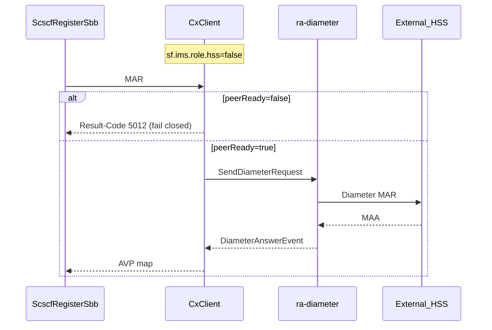
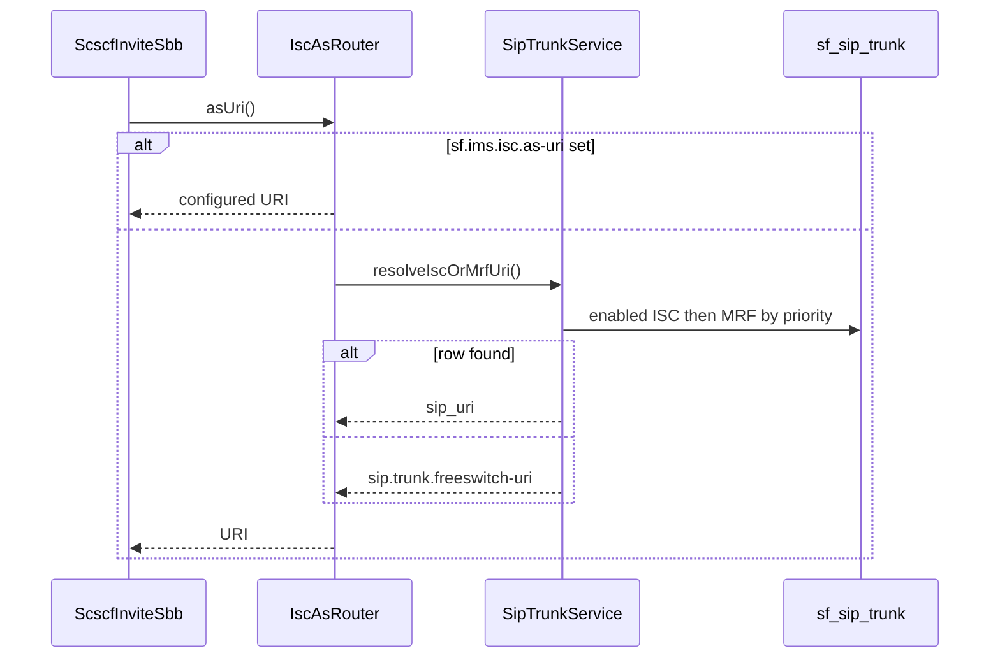
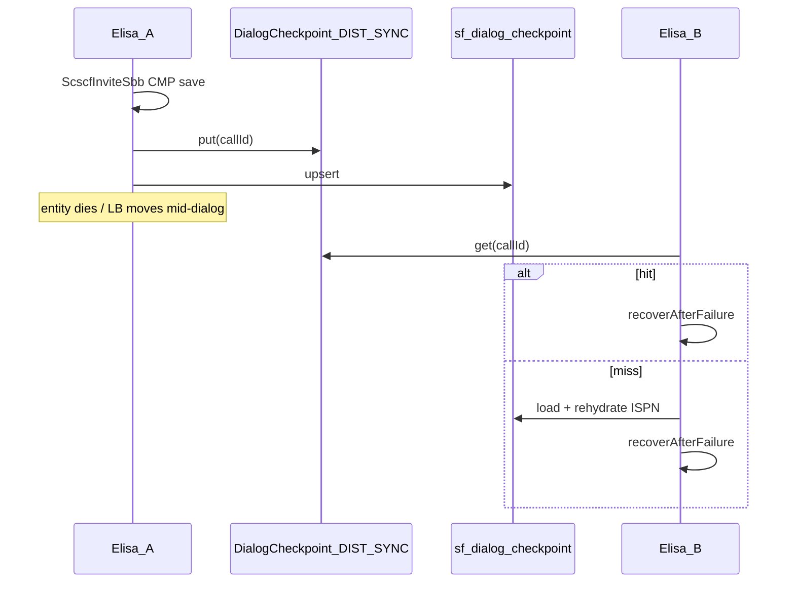

# Elisa → real IMS (Clearwater-parity + 3GPP) — protocol roadmap

**Goal:** Close the gap from lab IMS Core (grill I1–I8) toward Clearwater-equivalent CSCF/HSS/charging **without** violating Never locks (no PFCP/N4, Gx, Gy, RTP-through-Elisa, SBC).

**Spec cache:** [`docs/3gpp/`](../3gpp/README.md) (TS 23.228, 24.229, 29.228/229, 32.260/299, 33.203 — Rel-16 ETSI PDFs + MD extracts).

---

## 1. Inventory — what Elisa has now

### Diameter — **Yes (Cx), Partial (charging)**

| Piece | Path / knob | Status |
|-------|-------------|--------|
| Vendor RA | `jain-slee` `ra-diameter` → `DiameterResourceAdaptor` / `DiameterRaEndpoint` | Have |
| Wire in bootstrap | `elisa/.../bootstrap/ElisaBootstrap.java` → `wireDiameterRa()` when `sf.ims.cx.enabled` **and** I/S-CSCF or HSS role | Have |
| Peer truth | `DiameterRaBridge.peerReady()` / `peerConnected()` → `isPeerReady()` (CER/CEA) — admin IMS + CxClient gate when `hss=false` | Have (P0 hardened) |
| Cx client | `et.elisa.ims.cx.CxClient` — UAR/MAR/SAR/LIR; **local HSS-lite** when `sf.ims.role.hss=true`; else Diameter RA **only if peerReady** (5012 if not) | Have (lab) |
| Cx server | `CxServer` + `DiameterCxSbb` maps `DiameterRequestEvent` / `DiameterAnswerEvent` | Have (lab) |
| Codec | `CxCodec` (TS 29.229 command / AVP map as strings) | Partial (lite AVPs) |
| Config | `sf.ims.cx.*` listen/origin/dest in `application.properties` | Have |
| Rf ACR | `DiameterRfAcrEmitter` + `RfCodec` — ACR via `ra-diameter` when peerReady; log fallback | Partial (P0 flagged) |
| Ro / Gy / Gx / Rx | Ro-like = CGRates SessionS (flagged); Gx/Gy **Never**; Rx **No** | SessionS Partial |

**Answer:** Elisa **already has Diameter** for **Cx** via `ra-diameter`. Combined-node lab often never hits the wire (HSS-lite in-process). Remote Cx needs `sf.ims.role.hss=false` + peer CER/CEA (`peerReady=true`). Rf ACR is production-capable behind flags (`sf.ims.feature.charging` + `sf.rf.enabled`); soft-fallback log when peer not ready.

### SIP trunk / ISC — **Have (P0 registry)**

| Piece | Path | Status |
|-------|------|--------|
| Legacy edge trunk | `sip.trunk.freeswitch-uri` / `sip.trunk.domain` → `ProxySbb` (props fallback) | Have |
| ISC AS URI | `sf.ims.isc.as-uri` → `ImsRoleFlags` overrides all | Have |
| Trunk table | Flyway `V3__sip_trunk.sql` → `sf_sip_trunk` + `SipTrunkEntity` / `SipTrunkService` | **Have (P0)** |
| Pick order | `sf.ims.isc.as-uri` → primary enabled ISC (else MRF) by priority → props | **Have** |
| Admin | `/admin/trunks` HTMX | **Have** |
| S-CSCF INVITE | `ScscfInviteSbb` → `IscAsRouter.asUri()` | Have (iFC-lite) |
| Trunk ≠ listen UP | Peer row is config; link UP still FS Sofia / ESL plane | Honest |

### N–N Profile / CMP — **Have (P0 plane)**

| Piece | Path | Status |
|-------|------|--------|
| Shared ISPN manager | `ElisaInfinispanManager` — one `sf.cluster.infinispan.cluster-name` | **Have (P0)** |
| Caches | dialog-checkpoints, call-sessions, reg-home, dialog-owners | **Have** (same cluster) |
| Mode | `sf.cluster.infinispan.mode=LOCAL\|DIST_SYNC` | Documented; compose sets DIST_SYNC |
| CMP dual-write | `DialogCmpPersistence` ISPN → PG `sf_dialog_checkpoint` | Have |
| Cross-node restore | Unit sim: shared memory map + `DialogCmpCrossNodeRestoreTest` | **Have (P0)** |
| ProfileFacility | `ElisaProfiles` / `InMemoryProfileFacility` — **JVM-local** | Documented: **not** live INVITE SoT |
| Live INVITE SoT | CMP + ISPN/PG (+ ownership fence) | **Locked** (avoid USSD ussdUser footgun) |
| Registration sticky | `RegistrationHomeStore` + PG `ims_binding.home_scscf_node` | Have |
| FS pair C3 | `sf_fs_pair` / `FsPairRegistry` | Have |

### Clearwater name map (feature, not product parity)

| Clearwater | Role | Elisa today |
|------------|------|-------------|
| **Bono** | P-CSCF / edge | `PcscfProxySbb` + nginx L4 VIP — Partial |
| **Sprout** | I/S-CSCF | `IcscfRoutingSbb` + `ScscfRegisterSbb` / `ScscfInviteSbb` — Lab |
| **Homestead** | HSS/Cx | `HssLiteService` + optional Cx over `ra-diameter` — Lab |
| **Ralf** | RF / billing | Rf stub + CGRates CDRsV1 path — Partial |
| **Chronos** | timers / subscription | **No** (SLEE timers only) |
| **Homer** | Vellum/store | PG + Infinispan — different shape |

---

## 2. Protocol matrix — “IMS chính hiệu”

| Protocol / interface | Spec | Clearwater map | Elisa status | Priority |
|----------------------|------|----------------|--------------|----------|
| **Diameter base** (CER/CEA, watchdog) | RFC 6733 | under Homestead/Ralf | **Have** (`ra-diameter` + `peerReady`) | P0 keep |
| **Gm** SIP (UE↔P) | TS 24.229 | Bono | **Partial** (REGISTER/INVITE Path/PAI; AKA lab) | P0 |
| **Mw** SIP (P↔I↔S) | TS 24.229 | Bono↔Sprout | **Partial** (co-located often skip wire; split deploy flags exist) | P0 |
| **ISC** SIP (S↔AS) | TS 23.228 / 24.229 | Sprout→AS | **Partial** (trunk table + iFC-lite; not full iFC XML) | P0 |
| **Cx** | TS 29.228 / 29.229 | Homestead | **Have** (lab lite; remote when HSS off + peerReady) | P0 |
| **SIP trunk registry** | (ops) | AS peers | **Have (P0)** `sf_sip_trunk` | — |
| **N–N CMP / ISPN** | (ops) | Sprout cluster | **Have (P0)** shared manager + DIST_SYNC knobs; 100-server path → [`multi-service-deploy.md`](multi-service-deploy.md) § 100-server | — |
| **Dx** (SLF) | TS 29.228 | Homestead multi-HSS | **No** | P3 |
| **Sh** (AS↔HSS) | TS 29.328 / 29.329 | AS/Homestead | **No** | P2 |
| **Dh** | TS 29.328 | SLF for Sh | **No** | P3 |
| **Rf** (offline ACR) | TS 32.260 / 32.299 | Ralf | **Partial** (ACR START/STOP via ra-diameter + log fallback; dual-write CDRsV1) | P1 |
| **Ro** (online) | TS 32.299 | — / OCS | **Partial** CGRates SessionS + deferred debit (flagged off) | P1–P2 |
| **Rx** (PCRF) | TS 29.214 | — | **No** | P3 / external |
| **Gx** / **Gy** | — | — | **Never** | — |
| **Ut / XCAP** | TS 24.623 | MMTel | **No** | P2 |
| **ENUM** | RFC 3761 | Sprout ENUM | **Partial** (DNS on; no NAPTR lab) | P2 |
| **PFCP / N4** | TS 29.244 | — | **Never** | — |

---

## 3. USSDGW lessons applied

- Trunk rows = peer + URI + enabled; PG shared → any S-CSCF picks same primary.
- Diameter link truth = `isPeerReady()`, never LISTEN.
- Profile JVM-local until durable store installed — Elisa live call SoT = **CMP/ISPN/PG**, not Profile alone.

---

## 4. Phased plan (within Never locks)

```text
Phase 0  KEEP + P0 landed: trunk registry, Cx peer gate, shared ISPN N–N plane, CMP restore tests
Phase 1  Production P0 ops + Rf/SessionS feature-flagged (charging OFF by default) — see production-p0.md
Phase 2  ENUM optional / richer iFC when grilled
Phase 3  Sh/Ut/MMTel extras only if grilled
Never   PFCP/N4, Gx, Gy, RTP in Elisa, nginx-as-P-CSCF
```

| Phase | Work | Exit criteria |
|-------|------|---------------|
| **P0** | Trunk + Cx honesty + N–N CMP/ISPN docs/tests | **Landed 2026-08-10** |
| **P0b** | Production P0 checklist (prod.env, admin peer truth, charging flags off) | **Landed 2026-08-10** — [`production-p0.md`](production-p0.md) |
| **P1b** | Rf ACR on `ra-diameter` + SessionS INVITE gate + PG pending | **Landed (flagged)** — enable via `sf.ims.feature.charging` |
| **P2b** | ENUM / DNS NAPTR | SIPp MO to E.164 |
| **P3** | Sh/Ut/Presence if grilled | Explicit product grill |

---

## 5. Sequences

### Remote Cx (split HSS)



### Trunk selection (ISC)



### N–N CMP restore



---

## 6. Related paths

| Concern | Elisa | USSDGW reference |
|---------|-------|------------------|
| Diameter bootstrap | `ElisaBootstrap.wireDiameterRa` | `DiameterApplyService` |
| Peer ready | `DiameterRaBridge` / CxClient gate | `LinkStatusService.diameterLive` |
| ISC / trunk | `SipTrunkService`, `IscAsRouter`, `/admin/trunks` | `docs/as-contract/sip-trunk.md` |
| N–N ISPN | `ElisaInfinispanManager` | — |
| CMP | `DialogCmpPersistence`, `cmp-recovery.md` | — |
| Profile | `jainslee-profile.md` (JVM-local vs CMP SoT) | ussdUser lesson |
| Specs | `docs/3gpp/` | — |
