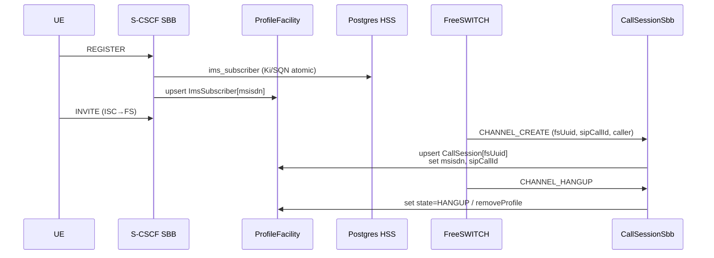

# Elisa ↔ micro-jainslee Profile (JAIN SLEE 1.1 / JSR-240 §10)

**Status:** **implemented** (lab P1) — ProfileSpecification classes + bootstrap tables + REGISTER/CHANNEL upserts.  
**Not this doc:** HTMX `/admin/profiles` (operator UI over Postgres). That page is admin CRUD, not the SLEE Profile Facility.

Related: [`user-profile.md`](user-profile.md) (current Elisa PG/ISPN locks), [`datastore.md`](datastore.md), runtime guide [`jain-slee/docs/en/profile-programming-model.md`](../../../../jain-slee/jain-slee/docs/en/profile-programming-model.md).

---

## 1. What “profile của micro-jainslee” means

In **JSR-240 / JAIN SLEE 1.1 §10**, a Profile is a **named row in a ProfileTable**, typed by a **ProfileSpecification** (CMP fields + local handle). SBBs access it only via **`SbbContext.getProfileFacility()`** — shared across SBB entities, not entity-local CMP.

| JSR-240 §10 term | micro-jainslee today | Classic Rhino / full TCK |
|------------------|----------------------|---------------------------|
| **ProfileFacility** | `com.microjainslee.api.ProfileFacility` — **implemented** (`InMemoryProfileFacility`) | Spec facility |
| **ProfileTable** | `ProfileTable` + `createProfileTable(name)` | Named table of one ProfileSpec |
| **ProfileID** | `ProfileID(tableName, profileName)` | table + profile name PK |
| **ProfileLocalObject** | `ProfileLocalObject` + `getProfile()` | Spec local interface |
| **Profile / CMP** | `Profile` + `ProfileAbstractCmp` (JavaBeans get/set → hot map) | Abstract profile class / generated CMP |
| **ProfileSpecification** | **App class** extending `ProfileAbstractCmp` (no XML deploy descriptor) | XML + separate Management/Local interfaces |
| **Indexed query** | `registerIndex` + `findProfilesByAttribute` | ProfileTable finder / indexed attrs |
| **Profile events** | Opt-in `enableEvents` → `ProfileEventSink` | ProfileAdded/Updated/Removed → SBB |
| **Management MBean** | **Out of scope** (micro-jainslee non-goal: no JSR-77) | ProfileProvisioning MBean |

**Rule (C9):** recovery / shared subscriber+session state → **Profile**. Ephemeral handler pointers → **SBB CMP** (`profileKey` only).  
**Call continuity:** entity-local CMP + dual ISPN/PG write-through — see [`cmp-recovery.md`](cmp-recovery.md).  
**Dead SBB orchestrator (design):** detect / fence / respawn local or sticky-home — [`sbb-recovery-manager.md`](sbb-recovery-manager.md).

---

## 2. Runtime status TODAY (jain-slee)

### Implemented (usable now)

| Area | Paths |
|------|--------|
| API | `jainslee-api/.../ProfileFacility.java`, `ProfileTable`, `ProfileID`, `Profile`, `ProfileLocalObject`, `ProfileAbstractCmp`, `ProfileStore` / `DurableProfileStore`, events |
| Core | `jainslee-core/.../InMemoryProfileFacility.java`, `InMemoryProfileTable`, `SimpleProfileLocalObject`, `ProfileAttachment`, wired from `MicroSleeContainer.getProfileFacility()` / `installDurableStore` |
| Durable SPI | `jainslee-profile-infinispan/.../InfinispanProfileStore.java` |
| Tests | `InMemoryProfileFacilityTest`, `AdvancedProfileFacilityTest`, `ProfileWriteRollbackTest` |
| Examples | `UssdSubscriberProfile` (ussdgw examples), `SipDialogSessionProfile` (`example-quarkus-sip`), helloworld `SessionProfile` / `AppUserProfile` |
| Docs | `docs/en/profile-programming-model.md` |

`SbbContext.getProfileFacility()` returns the facility (legacy alias `ProfileTablePort` still extends it).

### Gaps vs full JSR-240 ProfileSpecification (do not block Elisa lab)

| Gap | Notes | Elisa impact |
|-----|-------|--------------|
| No deploy-descriptor XML / `ProfileSpecificationID` | Spec is a Java class + table name string | Accept — same as other micro-jainslee shortcuts |
| No separate Profile Management interface | Provision via Facility / bootstrap | OK for lab; admin HTMX can later call Facility or stay on PG |
| No APT `@Profile` / `@ProfileIndexed` | Explicit `registerIndex` | Required at bootstrap |
| TCK harness `getProfileTable*` still TODO | `jainslee-tck-harness/.../MicrojainsleeContainerAdapter.java` | Not Elisa path |
| Profile events → EventRouter SBB map | Custom `ProfileEventSink`, not full §10.12 delivery | Optional later |
| `gap-analysis.md` silent on §10 | Facility exists; gap doc lag | Document here |

**Verdict:** Facility is **not stub-only**. Smallest Elisa slice = app ProfileSpecification classes + bootstrap tables + SBB upserts. No large jainslee-core rewrite required for lab P1.

---

## 3. Elisa mapping — MSISDN ↔ session (composition)

Follow micro-jainslee composition: **same `profileKey` across tables**, not one mega-row.

```text
profileKey (subscriber) = msisdn   (preferred) | impi if no MSISDN
profileKey (call)       = fsUuid   (FS Unique-ID) — secondary indexes: sipCallId, msisdn

ImsSubscriberProfile[msisdn]     ← identity / directory (hot mirror of ims_subscriber)
CallSessionProfile[fsUuid]       ← live call correlate (replaces / wraps CallSessionStore hot path later)
```

Do **not** put AKA `ki` / `opc` / live `sqn` in Profile CMP for Phase 1 (HSS SQN stays **Postgres-only** atomic — see `datastore.md`).

### Proposed ProfileSpecifications (Elisa app — not jainslee-api)

#### A. `ImsSubscriberProfile` — table `ImsSubscriber` — **implemented** (`et.elisa.profile`)

| CMP field | Type | Notes |
|-----------|------|--------|
| `msisdn` | String | Equals profile name when known |
| `impi` | String | Indexed |
| `impu` | String | Indexed |
| `tenantId` | String | Indexed |
| `displayName` | String | |
| `fsA1Hash` | String | Directory / digest helper (non-secret A1 hash only) |
| `enabled` | String | `"true"`/`"false"` (C7 whitelist — prefer String/boxed; or Boolean boxed) |
| `updatedAtEpochMs` | Long | |

**PK:** `profileName = msisdn` (or `impi` if MSISDN absent).  
**Indexes:** `impi`, `impu`, `tenantId`.

#### B. `CallSessionProfile` — table `CallSession` — **implemented** (`et.elisa.profile`)

| CMP field | Type | Notes |
|-----------|------|--------|
| `fsUuid` | String | Equals profile name |
| `sipCallId` | String | Indexed |
| `msisdn` | String | Indexed → join to subscriber |
| `tenantId` | String | |
| `elisaNodeId` | String | |
| `fsNodeId` | String | |
| `direction` | String | |
| `state` | String | CREATE / ANSWER / HANGUP / … |
| `startedAtEpochMs` | Long | |
| `updatedAtEpochMs` | Long | |
| `checkpointJson` | String | Optional Phase-3 `ProfileAttachment` |

**PK:** `profileName = fsUuid`.  
**Indexes:** `sipCallId`, `msisdn`.

`CallSession.profileId` (Long PG id today) becomes **SLEE `ProfileID`** conceptually (`ImsSubscriber` / msisdn), not a JDBC surrogate.

### N–N vs JVM-local Profile (P0 lock — 2026-08-10)

| Store | Cluster-safe? | Role |
|-------|---------------|------|
| `InMemoryProfileFacility` (default) | **No** — JVM-local | Hot mirror / indexes for directory + admin |
| `DialogCmpPersistence` → ISPN + PG | **Yes** when `DIST_SYNC` | **Live INVITE SoT** for restore |
| `CallSessionStore` / `RegistrationHomeStore` | **Yes** (shared `ElisaInfinispanManager`) | Session + home sticky |
| `sf_sip_trunk` | **Yes** (Postgres) | ISC URI on any S-CSCF |

**Do not** treat `CallSessionProfile` as the failover source of truth (USSDGW `ussdUser` footgun). Install `InfinispanProfileStore` later if Profile itself must be N–N; until then CMP/ISPN/PG owns mid-dialog identity.

Config: `sf.cluster.infinispan.mode=DIST_SYNC` + shared `sf.cluster.infinispan.cluster-name` (default `elisa-cluster`).

---

## 4. SBB call pattern (JSR-240 style)

```java
ProfileFacility pf = sbbContext.getProfileFacility();
// Prefer MicroSleeContainer.getProfileFacility() from CDI services —
// do NOT use the Quarkus ProfileTablePort bean (legacy stub; no registerIndex).
```

Elisa wiring (implemented):

| Path | Code |
|------|------|
| Bootstrap tables + indexes | `ElisaBootstrap` → `ElisaProfileService.provisionTables()` → `ElisaProfiles.provision` |
| REGISTER success | `ScscfRegisterSbb` → `upsertSubscriber` (non-crypto fields) |
| Admin provision | `ProfileAdminRoutes` / `ImsAdminRoutes` → `upsertSubscriber` |
| CHANNEL create/answer | `CallSessionService.upsertFromFs` → `upsertCallSession` |
| CHANNEL hangup | `CallSessionService.endByFsUuid` → `endCallSession` (state + remove) |

Helpers: `et.elisa.profile.ElisaProfiles` (pure Facility), `ElisaProfileService` (CDI).

```java
ProfileFacility pf = sbbContext.getProfileFacility();

// REGISTER / HSS provision path (identity hot mirror)
pf.createProfileTable(ImsSubscriberProfile.TABLE); // bootstrap once
ProfileLocalObject row = pf.getProfile(new ProfileID(ImsSubscriberProfile.TABLE, msisdn));
if (row == null) {
    row = pf.createProfile(ImsSubscriberProfile.TABLE, msisdn, ImsSubscriberProfile.class);
}
ImsSubscriberProfile sub = (ImsSubscriberProfile) row.getProfile();
sub.setImpi(impi);
sub.setImpu(impu);
// …

// CHANNEL_CREATE / CHANNEL_* (session)
pf.createProfileTable(CallSessionProfile.TABLE);
ProfileLocalObject sess = pf.getProfile(new ProfileID(CallSessionProfile.TABLE, fsUuid));
if (sess == null) {
    sess = pf.createProfile(CallSessionProfile.TABLE, fsUuid, CallSessionProfile.class);
}
CallSessionProfile cs = (CallSessionProfile) sess.getProfile();
cs.setSipCallId(sipCallId);
cs.setMsisdn(msisdn);
cs.setState("CREATE");

// Lookup by SIP Call-ID (after registerIndex)
Collection<ProfileLocalObject> hits =
    pf.findProfilesByAttribute(CallSessionProfile.TABLE, "sipCallId", sipCallId);
```

Bootstrap (Elisa): `createProfileTable` + `registerIndex` for `impi`/`impu`/`sipCallId`/`msisdn` before traffic — same pattern as `UssdDemoBootstrap.seedProfiles()`.

Wire points (existing): `CallSessionSbb` (FS channel), REGISTER / HSS path (`Scscf*` / admin provision — keep PG write for SQN; **also** upsert Profile identity fields).

---

## 5. Relation to Postgres + Infinispan (grill options)

| Option | Behavior | Recommend |
|--------|----------|-----------|
| **A. Dual — Profile hot + PG SoT (HSS)** | REGISTER writes PG `ims_subscriber` (Ki/SQN) **and** upserts `ImsSubscriberProfile` (non-crypto fields). Call: Profile (± ISPN store) primary; PG `sf_call_session` archive optional | **Lab default** |
| **B. Cache-through Profile** | Profile is only cache; miss → Panache load → populate Profile | Extra latency on miss; OK later |
| **C. Profile-only** | Drop PG for sessions; HSS still PG | Too early — breaks admin/CDR joins |

**Durable Profile backend:** prefer `MicroSleeContainer.installDurableStore(InfinispanProfileStore)` when clustering — aligns with existing Elisa ISPN. Until then in-memory Facility is fine for single-node lab (RPO = flush interval).

**Non-goal:** replace `/admin/profiles` HTMX with Profile MBeans. Admin may keep reading PG; later optionally list via Facility.

---

## 6. Sequence (lab)



---

## 7. Smallest implementable slices

### Runtime (only if needed)

1. Ensure Elisa Quarkus host exposes `container.getProfileFacility()` to SBBs (already via `SimpleSbbContext` when container wires it — verify `ElisaBootstrap`).
2. Optional: `installDurableStore(InfinispanProfileStore)` — **not** required for first green test.
3. Do **not** implement full ProfileSpecification XML / JMX for Elisa.

### Elisa (preferred first PR) — **done**

1. ~~Add `ImsSubscriberProfile` + `CallSessionProfile` under `et.elisa.profile`~~ 
2. ~~Bootstrap tables + indexes in `ElisaBootstrap`~~ 
3. ~~Upsert from `CallSessionService` on CHANNEL_*; upsert identity from REGISTER / admin provision~~ 
4. Keep PG HSS + optional `sf_call_session` dual-write until Profile+ISPN store proven.
5. Leave HTMX `/admin/profiles` as PG admin; rename nav label later (“IMS subscribers”) to avoid confusion with SLEE Profile.

### Tests

- Unit: `ElisaProfilesTest` — create table → create profile by msisdn → find by `sipCallId` index → hangup remove.
- Mirror `CallSessionSbbTest` stubbing `CallSessionService` (Profile upsert sits inside the service).

### API gap (micro-jainslee Quarkus adapter)

`MicroJainsleeProducer.profileTablePort()` returns `ProfileTablePortQuarkusAdapter` wrapping a **separate** `InMemoryProfileTablePort` stub where `createProfile` / `registerIndex` throw `UnsupportedOperationException`. Elisa **must** use `MicroSleeContainer.getProfileFacility()` (`InMemoryProfileFacility`) — same instance SBBs see via `SbbContext.getProfileFacility()`.

---

## 8. Grill locks (proposed)

| Id | Decision |
|----|----------|
| **JP1** | Telephony identity+session hot path uses **JAIN SLEE 1.1 ProfileFacility**, not HTMX-only “profiles” |
| **JP2** | Two tables: `ImsSubscriber` (PK msisdn/impi) + `CallSession` (PK fsUuid); compose via msisdn |
| **JP3** | HSS Ki/SQN remain **Postgres SoT**; Profile mirrors non-crypto identity |
| **JP4** | No mega-row; no secrets in Profile CMP |
| **JP5** | Full JSR-240 XML ProfileSpecification / MBean = **out of scope**; Java `ProfileAbstractCmp` is the lab ProfileSpecification |

---

## 9. Clarification (VI + EN)

**VI:** “Profile của micro-jainslee” = **Profile Facility JSR-240 §10** (ProfileTable / ProfileID / ProfileLocalObject), SBB gọi `getProfileFacility()`. **Không** phải trang HTMX `/admin/profiles`.

**EN:** Use the runtime Profile Facility already in micro-jainslee; Elisa should define ProfileSpecification classes and upsert on REGISTER/CHANNEL. Postgres remains HSS SoT; Profile is the SLEE-shared hot map (optionally durable via Infinispan ProfileStore).
