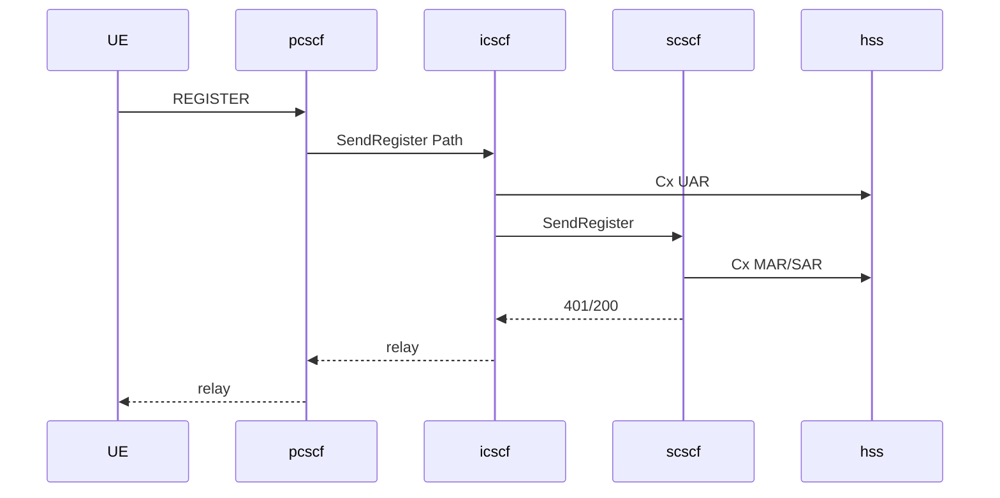

# Multi-service deploy — one code, N–N by role

**Lock:** same Elisa artifact (`elisa` image / `dist/elisa/`) for every CSCF/HSS process. Role plane is **config only** (`SF_IMS_*`). N Elisa + **N FreeSWITCH (essential, 1:1 with S-CSCF)** via C1/C2/C3. Soft-fail ESL when a FS peer is down is OK; omitting FS from compose/profiles for full voice IMS is **unsupported**.

## One codebase → many services

| Service (compose) | Image | Role flags | Planes |
|-------------------|-------|------------|--------|
| `elisa` (lab default) | elisa | P+I+S+HSS | SIP + ESL + Cx + admin (`depends_on` `freeswitch`) |
| `pcscf` | **same** | P only | SIP Gm → Mw to I |
| `icscf` | **same** | I only | SIP Mw + Cx client → S |
| `scscf` (×N) | **same** | S (+ optional HSS) | SIP Mw/ISC + ESL + Cx (`depends_on` paired FS) |
| `hss` | **same** | HSS only | Diameter Cx (no SIP/ESL) |
| `freeswitch` (×N) | FS image | n/a | **Essential** MRF/AS + ESL — always paired with S |
| `nginx` | edge | n/a | VIP SIP + admin HTTP |

```text
UA ──VIP──► nginx ──► pcscf (×N, affinity)
                 │ Mw
                 ▼
              icscf ──Cx UAR/LIR──► hss (or scscf+hss)
                 │ Mw
                 ▼
         scscf-1 .. scscf-N  ←── Infinispan DIST_SYNC (C1)
                 │ ESL pair (C3)
                 ▼
         freeswitch-1 .. freeswitch-N
```

Env templates: [`deploy/elisa/roles/`](../../deploy/elisa/roles/).
Compose overlay: [`docker-compose.services.yml`](../../docker-compose.services.yml).

```bash
# Lab all-in-one (unchanged)
docker compose up -d --build

# Split services (P / I / S / HSS) — scale down combined elisa + default nginx
docker compose -f docker-compose.yml -f docker-compose.services.yml \
  --profile services up -d --build --scale elisa=0 --scale nginx=0

# + second S-CSCF / FreeSWITCH pair
docker compose -f docker-compose.yml -f docker-compose.services.yml \
  --profile services --profile nn up -d --build --scale elisa=0 --scale nginx=0
```

## Role env (examples)

```bash
# P-CSCF
SF_IMS_PCSCF=true SF_IMS_ICSCF=false SF_IMS_SCSCF=false SF_IMS_HSS=false
SF_IMS_ICSCF_URI=sip:icscf:5060
SF_IMS_PCSCF_URI=sip:pcscf.ims.lab:5060   # VIP hostname clients see

# I-CSCF
SF_IMS_PCSCF=false SF_IMS_ICSCF=true SF_IMS_SCSCF=false SF_IMS_HSS=false
SF_IMS_SCSCF_URI=sip:scscf:5060
SF_IMS_CX_DEST_HOST=hss

# S-CSCF node i
SF_IMS_PCSCF=false SF_IMS_ICSCF=false SF_IMS_SCSCF=true SF_IMS_HSS=false
SF_CLUSTER_NODE_ID=elisa-scscf-1
SF_CLUSTER_INFINISPAN_MODE=DIST_SYNC
SF_ESL_HOST=freeswitch-1
SF_TRUNK_FREESWITCH_URI=sip:1000@freeswitch-1:5060

# HSS-lite
SF_IMS_PCSCF=false SF_IMS_ICSCF=false SF_IMS_SCSCF=false SF_IMS_HSS=true
SF_IMS_CX_LISTEN_PORT=3868
```

Unsupported on **one** process: P+I without S (Path vs UAR ownership). Use all-in-one or separate containers.

## N–N (grill I7)

| Plane | Mechanism |
|-------|-----------|
| Dialog / reg home | Infinispan `DIST_SYNC` + `home_scscf_node` |
| SIP VIP | nginx stream → P-CSCF pool (src-IP affinity) |
| FS pair | `sf_fs_pair` / `SF_CLUSTER_NODE_ID` → ESL primary |
| Sessions | `CallSessionStore` dual-write (ISPN + PG) on S-CSCF |

See [`cluster-c2-vip-affinity.md`](cluster-c2-vip-affinity.md), [`ims-core.md`](ims-core.md), [`nginx-ingress.md`](nginx-ingress.md).

## Bootstrap gates

| Plane | When wired |
|-------|------------|
| SIP RA | any CSCF **or** IMS disabled (legacy edge) |
| FreeSWITCH RA + `CallSessionSbb` | S-CSCF **or** IMS disabled — **RA stays in tree**; FS peer is **essential** for live voice (soft-fail ESL ≠ omit FS) |
| Diameter Cx | I / S / HSS when `sf.ims.cx.enabled` |

## Mw path (split)



INVITE: P stamps PAI + Route → I LIR → S ISC → paired FreeSWITCH.

## 100-server N–N path (ops model)

**Server ≠ physical box.** A “server” here is a **process role** behind a VIP: `pcscf` / `icscf` / `scscf` / `hss` (same `dist/elisa/` image, `SF_IMS_*` only), plus `freeswitch`, `nginx`, shared **Postgres**, and **coturn** (RTP bypass). One host may run several roles; ~100 capacity units ≈ N×P + N×I + N×S + N×HSS + N×FS, not 100 all-in-one Elisas.

| Plane | Path at scale |
|-------|----------------|
| Gm VIP | nginx `stream` → **P-CSCF pool** (`hash $remote_addr`) — Path/Contact = VIP hostname (N6) |
| Mw | P → I (config `SF_IMS_ICSCF_URI`) → home **S** (Cx UAR/LIR `SERVER_NAME` / `SF_IMS_SCSCF_URI`) |
| Sticky S | `ims_binding.home_scscf_node` + ISPN `RegistrationHomeStore`; Service-Route on 200 |
| ISC + ESL | S node-id → `sf_fs_pair` primary FS; trunk URI = paired Sofia (`SipTrunkService` PG / per-node env) — **1:1 S↔FS required** (failover list OK as backup, not as “no FS”) |
| Shared SoT | Postgres (bindings, trunks, CMP durable); ISPN `DIST_SYNC` only among **S-CSCF** peers sharing `sf.cluster.infinispan.cluster-name` |
| Not on VIP | ESL `:8021`, Diameter Cx, ISC Elisa→FS, RTP/TURN |

```text
UE ──SIP VIP──► nginx ──► P×N ──Mw──► I×N ──Cx──► HSS×N
                              │              │
                              │ Mw           │ MAR/SAR/LIR
                              ▼              │
                           S×N ◄─────────────┘   (home sticky)
                            │ ESL pair + ISC trunk
                            ▼
                           FS×N     RTP ◄── coturn (no nginx)
```

**Honest limits today:** default ISPN `LOCAL`; one embedded JGroups view for all DIST peers (not sized/proven for ~100 members — keep ISPN membership ≈ S-CSCF count, P/I/HSS `LOCAL` or separate cluster-name); ProfileFacility still **JVM-local**; mid-dialog SIP continue after S-CSCF crash is **lab-grade** via `DialogCheckpoint.sipHa` → `DialogRegistry.restorePortable` (peers + synthetic lastRequest/tags) — not Chronos, still prefer L4 affinity for inbound. No Dx/SLF multi-HSS. Detail: [`cluster-c2-vip-affinity.md`](cluster-c2-vip-affinity.md), [`cmp-recovery.md`](cmp-recovery.md), [`ims-protocol-roadmap.md`](ims-protocol-roadmap.md).
