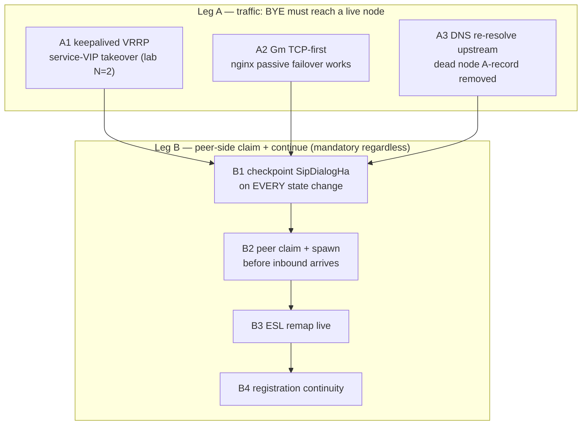
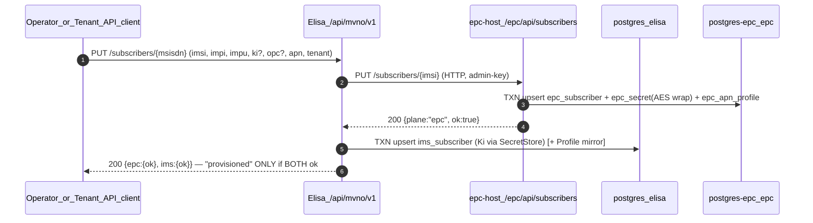

# MVNO improve plan — W1 / W2 / W3

**Status:** PROPOSAL (2026-08-26) — **nothing implemented**. Written for owner approval (duyệt) before any code. Covers the three highest-leverage items from the full-MVNO proposal chat: **W1** N–N mid-call dialog recovery (close the 2026-08-17 proven gap), **W2** unified MVNO provisioning, **W3** P-CSCF discovery via PCO in Create Session Response.

Grounded in code facts (paths verified 2026-08-26): [`cmp-recovery.md`](cmp-recovery.md) · [`sbb-recovery-manager.md`](sbb-recovery-manager.md) · [`cluster-c2-vip-affinity.md`](cluster-c2-vip-affinity.md) · [`lessons.md`](lessons.md) § N–N mid-call · [`epc-p1.md`](epc-p1.md) · [`elisa-improve-plan.md`](elisa-improve-plan.md).

---

## 0. Locks honored (unchanged)

| Lock | Applies |
|------|---------|
| nginx edge locked N1–N8; **N5 hash `$remote_addr consistent` stays**; round-robin **rejected** (peer 401 on bare INVITE — proven 2026-08-17) | W1 |
| Real fix = **peer-side dialog recovery** (ISPN/CMP + RA `restorePortable`), not nginx config | W1 |
| Elisa ≠ EPC JVM; `epc-cluster` ≠ `elisa-cluster`; `EpcJdbc.requirePostgres` throws on `/elisa` URL; **no schema merge, no cross-DB JDBC** | W2 |
| Ki/OPc stay Postgres SoT behind `key_ref`/SecretStore; no secrets in Profile/CMP | W2 |
| No Gx/Gy/PFCP/Rx in Elisa; no RTP through Elisa; FS essential 1:1 S-CSCF | all |
| JDK 25 only; Log4j2 only; prove-artifact + PCAP before any "done" claim | all |
| Vendor RAs live in `jain-slee/vendor-ras/`; epc depends on nhanth87 artifacts only | W3 |

---

## 1. W1 — N–N mid-call dialog recovery (close the 2026-08-17 gap)

### 1.1 Root cause (verified live)

REGISTER/INVITE all green, then mid-call `docker stop scscf` → UE BYE **never gets 200**:

1. **Traffic leg:** nginx Gm VIP pins UE → home S-CSCF (`hash $remote_addr consistent`, UDP). OSS nginx `stream` has **no active health check for UDP** (passive fails rely on TCP connect errors) → dead node is never pulled → BYE blackholed, peer never sees it.
2. **Recovery leg:** even if BYE reached the peer, peer-side claim/restore is wired **unit-tests only** — never proven live: `blockedSipHa` for dialogs whose `SipDialogHa` tags were not checkpointed at kill time; ESL remap (R9) unproven.

Test-harness fixes already landed: `loadtest/scripts/nn-midcall-kill-1000.sh` + `uac_midcall_reg_invite_1000.xml` (callee = `sip:1000` FS MRF, home resolved from PG `ims_binding.home_scscf_node`) — the old `sip:alice@ims.lab` self-loop bug is closed.

### 1.2 Design

#### Leg A options (grill decision — pick ONE, see §6)

| Opt | Mechanism | Lock fit | Trade-off |
|-----|-----------|----------|-----------|
| **A1** | **keepalived VRRP**: each S-CSCF pair shares a *service* SIP IP; on node death survivor takes over the IP (ARP). nginx upstream untouched; hash still lands on the same IP — now answered by survivor | N5 intact (affinity by construction); not round-robin; N1/N2/N7 untouched | Needs `NET_ADMIN` container(s) on the compose bridge; N>2 = VIP matrix per pair (lab is 2 → trivial) |
| **A2** | **Gm SIP/TCP first-class**: TCP connect-refused IS detected by nginx passive `max_fails` → server pulled → consistent-hash redistributes that UE to survivor | N2 already prefers TCP/TLS for prod; zero new components | UDP lab path stays best-effort (documented); SIPp harness must switch to TCP |
| **A3** | **DNS-driven upstream**: nginx `resolver` + short-TTL node records; sidecar withdraws dead node A-record → re-resolve redistributes | Works for UDP; no LB semantics change | Convergence = TTL seconds (BYE retransmits meanwhile — acceptable, RFC 3261 Timer F covers it); extra sidecar |

**Never:** round-robin / least_conn (locked — breaks REGISTER/auth context), Call-ID L7 hash in OSS nginx (unavailable), nginx health_check plus-only features.

**Recommendation:** **A1 for lab** (fastest deterministic prove, composes with C2 story) + declare **A2 the prod direction** (already N2-preferred). Final pick = owner.

#### Leg B (mandatory regardless of A)

| Step | Work | Ground truth today |
|------|------|--------------------|
| **B1** | Checkpoint completeness: enrich `SipDialogHa` (from/to tags, contact, cseq, route) on **every** CMP save point — EARLY **and** CONFIRMED/ACK/BYE/re-INVITE paths in `ScscfInviteSbb` + `DialogCmpPersistence`. Target: `blockedSipHa == 0` for any dialog past EARLY | Tags exported on CMP save (V4 cols exist) but cadence misses late transitions; sbb-recovery-manager.md §5.1 admits early-INVITE-only gaps |
| **B2** | Peer pre-claim: `onClusterViewChange(departed)` scan owners `state ∈ {EARLY, CONFIRMED}` → fence CAS gen+1 → `failoverSpawn` **before** the inbound BYE arrives (today spawn may also happen via Gap-SR-1 on inbound; both paths must converge on one entity — fence guarantees) | Manager API + fence exist (`DialogOwnerStore`); unit-tested only |
| **B3** | ESL remap live: `HomeEslRemapService` rebind `freeswitch-ra` fs-ch activities to checkpoint `fsNodeId` via `sf_fs_pair`; CHANNEL_HANGUP on home FS must reach the claiming node → clean CDR + SessionS Terminate | Wired (R9), unit tests only |
| **B4** | Registration continuity: fresh REGISTER post-kill must succeed via survivor (I-CSCF re-select or `ims_binding.home_scscf_node` rewrite on SAR); no stale pin to dead node in `RegistrationHomeStore` | Store exists; dead-node eviction unhandled |

### 1.3 Phases + exit criteria

| Phase | Work | Exit (all wire/artifact-gated) |
|-------|------|-------------------------------|
| **W1-a** | B1 checkpoint cadence + unit tests (`DialogCmpSipHaRestoreTest` extended: kill-at-CONFIRMED restores Send* without inbound) | `blockedSipHa==0` asserted in tests |
| **W1-b** | B2/B4 two-node integration test (shared ISPN JVM-pair sim of departure): peer spawns claimed entity pre-inbound; TERMINATED never respawns (R6) | Claim-won metric asserted; dual-spawn impossible (fence loser NOOP) |
| **W1-c** | Leg A implementation per grill pick (compose `keepalived` pair **or** TCP-first harness + nginx `max_fails` tuning) | `docker compose` brings up chosen leg; README steps |
| **W1-d** | Live prove: `nn-midcall-kill-1000.sh` — kill home mid-CONFIRMED → **BYE 200**, pcap saved; ESL remap evidenced (CHANNEL_HANGUP correlates → `sf_cdr` written); fresh REGISTER 401→200 + INVITE 200 afterwards. **Run 2× consecutive** (destructive-test hygiene: restart dead node, wait healthy + ISPN rebalance between runs) | pcap `sip.Status-Code==200` for BYE post-kill ×2; `production-p0.md` + `lessons.md` gap section updated to CLOSED with pcap links |

---

## 2. W2 — Unified MVNO provisioning API (identity glue)

### 2.1 Current state (facts)

| Store | Tables | Auth material | Provisioned how today |
|-------|--------|---------------|----------------------|
| Elisa PG `elisa` | `ims_subscriber` (impi uniq, impu, **ki/opc plaintext hex**, sqn, ifc_json, tenant_id, msisdn, fs_a1_hash), `ims_binding` | Plaintext columns read by `HssLiteService.handleMar` | HTML form `POST /admin/subscribers` (**default Ki hardcoded**) — no REST |
| EPC PG `epc` | `epc_subscriber` (imsi PK, key_ref, impi/impu_csv, impu_reg_state), `epc_secret` (**AES-wrapped** ki_enc/opc_enc/amf_enc + kek_version), `epc_apn_profile` | `JdbcSecretStore` + KEK from boot prop | Manual psql script `epc/loadtest/scripts/epc-seed-subscriber.sh` — no API |

No cross-write anywhere (enforced by `EpcJdbc.requirePostgres` / `HssBootstrap.requirePostgres`). Tenant concept (`sf_tenant`, reseller_id, role-scoped) exists **only in Elisa**.

### 2.2 Design — fan-out orchestrator, two planes, zero schema merge

Rules:

1. **Process separation kept:** EPC rows are written **only** inside the EPC JVM (new REST on `epc-host`, pattern = existing `EpcConfigResource` + admin key). Elisa holds an HTTP client, not a second JDBC URL to `epc`.
2. **Secret uplift in Elisa (W2-a):** mirror the EPC pattern — Flyway **V10** `ims_secret` (AES wrap + `kek_version`, `key_ref`=IMPI) + `SecretStore` port; `HssLiteService` reads vectors through the port; migrate existing plaintext rows at boot, then **drop plaintext columns**. Kill the hardcoded-default-Ki form path (`dev-login=true` labs only).
3. **Idempotency:** PUT-by-key full-state, both planes keyed independently (MSISDN↔IMSI↔IMPI join carried in payload); retry-safe; partial success reported honestly per plane — never aggregate a fake "OK".
4. **Order:** EPC first (auth material), IMS second; failure → compensating status in response, no silent half-state claims.
5. **Tenant (multi-MVNO):** propagate `sf_tenant.id` into EPC as nullable `tenant_id` (epc V8) for reporting/rate-plan grouping — **not** used in auth. Elisa role-scoping (`TenantService.canAccess`) gates who may provision whom.
6. **Auth:** API key model reuses `SF_ADMIN_API_KEY` + tenant `http_api_key`; `dev-login=false` in prod (existing P0 rules).
7. **Admin UI:** extend `/admin/subscribers` rows with plane badges `ims-ok / epc-ok` + last-sync timestamps (HTMX partial, admin-ui standard).

### 2.3 Phases + exit criteria

| Phase | Work | Exit |
|-------|------|------|
| **W2-a** | Elisa secret uplift (V10 + SecretStore port + boot migration + admin form hardening) | `mvn test` + packaged dist boots; MAR still answers 401 AKAv1-MD5 (ims-smoke); no plaintext Ki column remains |
| **W2-b** | EPC subscriber REST (PUT/GET/suspend; TXN across 3 tables; admin key; tenant_id col) | Unit + curl against compose `epc` profile; `epc_secret` row wrapped, `key_ref`=IMSI |
| **W2-c** | Elisa orchestration API + HTMX badges | Fan-out unit tests (mock EPC); compose integration: one PUT → both stores correct |
| **W2-d** | **Wire prove (the gate)**: provision brand-new identity via API → open5gs-MME S6a CEA+AIR/ULR green → SIPp REGISTER 401→200 AKAv1-MD5 → INVITE `sip:1000` 200 → `sf_cdr` row | Single scripted run `tools/mvno-provision-prove.sh`, all steps green + pcap; **no "full MVNO provisioning" claim before this** |

---

## 3. W3 — P-CSCF discovery via PCO (Create Session Response, TS 23.401 / 29.274)

### 3.1 Current state (facts)

- Vendor `ra-gtpv2c` codec preserves unknown IEs opaquely but has **no IE 78 (PCO)** constant/helpers.
- CSR builders hand-assemble IE lists in 4 places: `GtpGatewaySbb` (SGW S11 side + PGW S5 side), `PgwSbb.createSessionResponse`, `SgwcSbb`.
- `ApnConfig.pcscfIpv4` exists but every caller hardcodes `"192.0.2.10"` and **nothing encodes it** onto the wire.
- open5gs `mmed` (our lab MME) relays PCO NAS↔GTP but its configs contain no P-CSCF lines today.

### 3.2 Design

| Piece | Work |
|-------|------|
| **Vendor codec** (`jain-slee/vendor-ras/ra-gtpv2c`) | `Gtpv2Ie.PCO = 78`; `Gtpv2Ies.encodePco/decodePco` with EPS container ids (TS 24.008): `0x0001` P-CSCF IPv6, `0x0003` DNS IPv6, `0x000C` **P-CSCF IPv4**, `0x000D` DNS IPv4, `0x0010` IPv4 MTU. Support **both placements** (message-level IE 78 and IE 78 nested in Bearer Context §8.14); default emit = **message-level** (what open5gs SMF does) — final placement confirmed by interop on the wire, not by assumption |
| **Config/storage** | Env `epc.pco.pcscf-ipv4[+csv]`, `epc.pco.dns-ipv4` → `application.properties` (`epc.<k>=${EPC_<K>:default}`) → `@ConfigProperty` in `EpcRuntime`; per-APN override columns on `epc_apn_profile` (V8: `pcscf_csv`, `dns_csv`). **Advertised P-CSCF = the Gm VIP hostname/IP (N6)** — never a bare S-CSCF node IP |
| **Emission (PGW side)** | `ApnConfig` carries real values (delete `192.0.2.10` hardcodes); `PgwControl.createSession` → `CreateSessionResult` gains `List<PcoContainer>`; both PGW-side CSR builders append IE 78 when APN=`ims` (or PCO configured) |
| **Relay (SGW side)** | SGW-C **copies** PCO verbatim from S5-C CSR into S11 CSR (transparency rule); SgwcSbb + GtpGatewaySbb-SGW path; unknown-container pass-through preserved |
| **Request side** | Parse requested-PCO in CS Request (respond to what UE asked); when configured for IMS APN, include addresses even if UE sent empty PCO (operator policy flag) |

### 3.3 Phases + exit criteria

| Phase | Work | Exit |
|-------|------|------|
| **W3-a** | Codec + tests in vendor RA (round-trip encode/decode incl. grouped nesting) | `Gtpv2CodecTest` green; artifact version bumped; epc depends on new version |
| **W3-b** | Config + `ApnConfig`/`CreateSessionResult` plumbing + PGW emission + SGW relay | Builder unit tests assert IE 78 presence + container bytes; relay test S5→S11 (template `S5cWireTest`) |
| **W3-c** | Wire tier-1: extend `gtp-echo-smoke`-style client to send CS **Request** with requested-PCO → tshark asserts CSR IE 78 with `0x000C` = VIP addr on **both** hops (MME↔SGW S11, SGW↔PGW S5) | pcap saved under `epc/loadtest/pcaps/`; **honest label: GTP-wire PCO proven — UE/NAS-level delivery waits for epc-p1 Phase-2 attach (G3)** |
| **W3-d** | (deferred, depends on epc-p1 Ph-2) Real UE attach: NAS ESM shows P-CSCF → UE sends REGISTER straight to P-CSCF VIP | Part of G3 closure, not claimed here |

---

## 4. Execution order (recommended)

| Sprint | Items | Why this order |
|--------|-------|----------------|
| 1 | **W1-a, W1-b** (code-only) + **W2-a** (secret uplift) | Pure-code, no infra decisions; W1-a unblocks every later prove; security debt closed early |
| 2 | **W3-a, W3-b** (vendor codec + emission) + **W1-c** (Leg A build per grill pick) | Vendor RA bump has lead time; Leg A needs owner pick from §6 |
| 3 | **W1-d** (live kill prove ×2) + **W3-c** (PCO wire tier-1) | Destructive proves batched; both produce pcaps |
| 4 | **W2-b, W2-c, W2-d** (provisioning API + wire gate) | Lands last so its prove reuses W1-stable cluster |

Size feel: W1 ≈ 2–3 d · W2 ≈ 3–4 d · W3 ≈ 2–3 d (excluding owner-grill latency).

---

## 5. Explicit non-goals (this plan)

- No schema merge / shared DB / cross-JDBC between `elisa` and `epc`
- No plaintext Ki retention anywhere; no secrets in Profile/CMP
- No Gx/Gy/PFCP/Rx in Elisa; no RTP through Elisa; no SBC; no round-robin Gm
- No Chronos-class full SIP dialog SM claim — W1 scope = mid-dialog continue on node loss, honestly labeled lab-HA
- No UE-level VoLTE/VoNR claim until epc-p1 G3 attach PCAP (W3-d deferred)
- No charging flips (`sf.ims.feature.charging` stays off until its own grill)

---

## 6. Decisions (APPROVED by owner 2026-08-26 — recommendations locked)

| # | Question | Options | Locked decision |
|---|----------|---------|-----------------|
| D1 | W1 Leg A mechanism | A1 VRRP / A2 TCP-first / A3 DNS | **A1 for lab + A2 declared prod direction** |
| D2 | P-CSCF address advertised in PCO (W3) | VIP hostname per N6 vs node IP | **VIP (`pcscf.ims.lab` style), matches N6 Path/Contact policy** |
| D3 | EPC subscriber REST auth | reuse `SF_ADMIN_API_KEY` pattern vs new key | **reuse pattern** (one key family, per-env value) |
| D4 | Tenant propagation into EPC | nullable `tenant_id` col vs none | **add col** (reporting only, not auth) |
| D5 | W3 PCO default placement | message-level vs bearer-nested | **emit message-level, confirm by interop** |
| D6 | Drop plaintext Ki columns in Elisa after V10 migration | drop immediately vs keep read-only 1 release | **drop at migration** (boot-time copy, fail-closed) |

Status: **Sprint 1 started 2026-08-26** (W1-a, W1-b, W2-a). Any D-decision override = new grill with owner.

### Sprint 1 status (2026-08-26) — code landed, unit-proven, NOT yet wire-proven

| Item | Landed | Evidence |
|------|--------|----------|
| **W1-a** | `SipDialogHa.merge` (monotonic field-wise), `DialogCmpPersistence.mergeMonotonicHa` on every non-terminated save, ACK checkpoint flush, re-INVITE no-downgrade guard in `ScscfInviteSbb.onInvite` | `SipHaMonotonicCheckpointTest`, `ScscfInviteSbbCheckpointCadenceTest`; `blockedSipHa==0` asserted for rich CONFIRMED checkpoint |
| **W1-b** | `DialogOwnerStore.shareMemory` seam; two-node DIST_SYNC sim: peer claims orphan + rebuilds Send* wire pre-inbound; TERMINATED/no-checkpoint never claimed | `PeerPreClaimTwoNodeTest` |
| **W2-a** | Flyway V10 `ims_secret`; `ImsSecretCrypto` (AES-GCM, fail-closed wrong-KEK); `ImsSecretStore` (+`sf.ims.secret.kek-hex`); boot `ImsSecretMigrator` (wrap → drop plaintext cols); `HssLiteService.handleMar` reads wrapped material only (5001 when absent); admin forms refuse missing Ki outside dev-login | `ImsSecretCryptoTest`; elisa suite 199/199 green; `dist/elisa` packaged (jar major 69) |
| Open | W1-c/d (Leg A + live kill prove ×2), W2-b/c/d (EPC REST + fan-out + provision prove), W3-* | next sprints per §4 |

## 7. Pointers

| Doc | Role |
|-----|------|
| [`cmp-recovery.md`](cmp-recovery.md) · [`sbb-recovery-manager.md`](sbb-recovery-manager.md) | W1 primitives + remaining-gap list |
| [`lessons.md`](lessons.md) § N–N mid-call | W1 root cause + destructive-test hygiene |
| [`cluster-c2-vip-affinity.md`](cluster-c2-vip-affinity.md) · [`nginx-ingress.md`](nginx-ingress.md) | C2/N1–N8 constraints for Leg A |
| [`epc-p1.md`](epc-p1.md) | W3-d dependency (attach PCAP, G3) |
| [`elisa-improve-plan.md`](elisa-improve-plan.md) · [`production-p0.md`](production-p0.md) | Improve-plan house rules + go-live gate |
