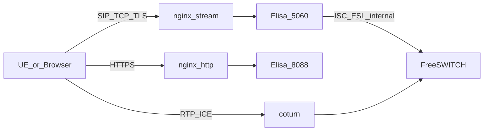

# nginx ingress — in front of Elisa (locked)

**Decision (2026-08-10):** nginx stands **in front**; Elisa CSCF / admin stay **behind**. nginx is **L4 SIP VIP + HTTPS reverse proxy** only — **not** a P-CSCF, **not** an SBC, **not** an RTP path.

## Locks (N1–N8)

| Id | Decision |
|----|----------|
| **N1** | Edge shape: `Client → nginx → Elisa` for **HTTPS admin** and **SIP signaling VIP** |
| **N2** | SIP via **`stream`** (TCP/TLS preferred; UDP optional lab) — no SIP application module |
| **N3** | Admin / xml_curl / ice-config via **`http`** (`proxy_pass` → `:8088`) |
| **N4** | **RTP / TURN bypass nginx** — coturn + FreeSWITCH media ports only ([`media-ice-turn.md`](media-ice-turn.md)) |
| **N5** | Mid-dialog affinity: `hash $remote_addr consistent` (or equivalent sticky); Call-ID L7 hash **out of scope** for nginx |
| **N6** | Elisa advertises **VIP hostname** in Path / Service-Route / Contact — never bare node IP to UEs |
| **N7** | ESL `:8021`, Diameter Cx, ISC Elisa→FS stay **internal** — not on public nginx |
| **N8** | No Kamailio/OpenSIPS required for lab edge; if SIP-aware LB needed later, that is a **separate** grill (not “nginx SIP plugin”) |

## Topology

```text
                         ┌──────────── nginx (edge) ────────────┐
UE / Browser ── HTTPS ──►│ http  :443  → Elisa :8088            │
UE ─────────── SIP ─────►│ stream:5060 → Elisa :5060 (pool)     │
                         └──────────────────────────────────────┘
                                    │
                    Elisa P/I/S-CSCF + HSS-lite (SIP SM)
                                    │ ISC + ESL (internal)
                                    ▼
                              FreeSWITCH MRF/AS
UE ─────────── RTP ─────► coturn ↔ FreeSWITCH RTP     ← no nginx
```



## Module matrix (what we use)

| Module | Role for Elisa | Use? |
|--------|----------------|------|
| `ngx_http_core` + `proxy` | Admin HTMX, `/fs/xml`, `/media/ice-config` | **Yes** |
| `ngx_http_ssl` (+ http2 optional) | TLS terminate admin | **Yes** |
| `ngx_stream_core` + `proxy` | SIP VIP TCP/UDP | **Yes** |
| `ngx_stream_ssl` / `ssl_preread` | SIP TLS terminate or passthrough | **Optional** |
| `ngx_stream_upstream` + `hash` | Sticky to Elisa node | **Yes** |
| Official “SIP app” module | Understand Via/Path/dialog | **None — do not invent** |
| Third-party nginx-SIP | Experimental CSCF-like | **No** (lab) |
| `nginx-rtmp` | RTMP video | **No** |
| stream UDP for RTP | Media LB | **No** (N4) |

Build: nginx must include `--with-stream` (official `nginx:alpine` has it built-in). Distro package often: `libnginx-mod-stream`.

## SIP stream (recommended sketch)

```nginx
stream {
  upstream elisa_sip {
    hash $remote_addr consistent;
    server 10.0.0.11:5060 max_fails=3 fail_timeout=10s;
    server 10.0.0.12:5060 max_fails=3 fail_timeout=10s;
  }

  # Prefer SIP over TCP (prod)
  server {
    listen 5060;
    proxy_pass elisa_sip;
    proxy_connect_timeout 5s;
    proxy_timeout 3600s;          # long-lived TCP for dialogs
    proxy_next_upstream on;
  }

  # Optional lab UDP — weaker affinity/NAT story
  server {
    listen 5060 udp reuseport;
    proxy_pass elisa_sip;
    proxy_responses 0;
    proxy_timeout 60s;
  }
}
```

**TLS SIP (optional):** either terminate on nginx (`listen 5061 ssl`) or `ssl_preread` passthrough to Elisa. Path/Contact still use public VIP name.

## HTTP admin (recommended sketch)

```nginx
http {
  upstream elisa_http {
    server 10.0.0.11:8088;
    server 10.0.0.12:8088;
  }
  server {
    listen 443 ssl;
    server_name elisa.example.lab;
    # ssl_certificate …;
    location / {
      proxy_pass http://elisa_http;
      proxy_http_version 1.1;
      proxy_set_header Host $host;
      proxy_set_header X-Forwarded-For $proxy_add_x_forwarded_for;
      proxy_set_header X-Forwarded-Proto $scheme;
      proxy_read_timeout 120s;
    }
  }
}
```

xml_curl from FreeSWITCH should hit Elisa on the **internal** network when possible (not hairpin public VIP). If FS must use nginx, allowlist FS source IPs on `/fs/xml`.

## Explicit non-goals

| Do not | Why |
|--------|-----|
| nginx as P-CSCF / REGISTER store | Elisa owns IMS SM ([`ims-core.md`](ims-core.md)) |
| Rewrite Via / Record-Route / Path in nginx | No SIP L7 |
| RTP or TURN through nginx stream | I6 + N4; use coturn/FS |
| Expose ESL / Diameter on nginx | Internal only |
| Rely on Call-ID hash in OSS nginx | Not available at stream L4 |
| Claim “SIP plugin” solves IMS | False — use Elisa; SIP-aware LB = later grill |

## Affinity vs IMS sticky

| Concern | Mechanism |
|---------|-----------|
| Same Elisa for ACK/BYE/re-INVITE | nginx `hash $remote_addr` (N5) |
| Registration home S-CSCF | `ims_binding.home_scscf_node` + ISPN ([`cluster-c2-vip-affinity.md`](cluster-c2-vip-affinity.md)) |
| FS pair | `sf_fs_pair` — trunk URI to paired Sofia, not FS VIP via nginx |

UDP SIP behind nginx: lab-only or pin UA; production **SIP/TCP or SIP/TLS**.

## Elisa config implications

| Item | Requirement |
|------|-------------|
| `sf.ims.pcscf-uri` / Path | Public VIP SIP URI (e.g. `sip:pcscf.example.lab:5060`) |
| Service-Route | S-CSCF URI reachable as designed (VIP or internal Mw) |
| ACL (`/admin/acl`) | See **client** IP if PROXY protocol / real_ip configured; else nginx IP — prefer `proxy_protocol` or `set_real_ip_from` on HTTP; for stream, document that ACL may see nginx unless PROXY proto to Elisa |
| Health | nginx passive fails; Elisa `/admin` or health for ops — do not map LISTEN-only to “link UP” |

## Relation to other docs

- Architecture: [`architecture.md`](architecture.md)
- IMS call flows: [`ims-core.md`](ims-core.md)
- Cluster VIP: [`cluster-c2-vip-affinity.md`](cluster-c2-vip-affinity.md)
- Media bypass: [`media-ice-turn.md`](media-ice-turn.md)

## Lab implement (repo)

| Path | Role |
|------|------|
| [`deploy/nginx/nginx.conf`](../../deploy/nginx/nginx.conf) | stream SIP + http `:8080` / TLS `:8443` |
| [`deploy/nginx/Dockerfile`](../../deploy/nginx/Dockerfile) | `nginx:1.27-alpine` + `ngx_stream_module` |
| [`docker-compose.yml`](../../docker-compose.yml) | `nginx` edge; Elisa `expose` only (no host SIP/admin ports) |

```bash
docker compose up -d --build
# admin  http://127.0.0.1:8080/admin/   (TLS https://127.0.0.1:8443/admin/)
# SIP    127.0.0.1:5060 → nginx stream → elisa:5060
# TURN   127.0.0.1:3478 (bypass nginx)
# FS xml_curl stays http://elisa:8088/fs/xml (internal)
```

Map `pcscf.ims.lab` → VIP/host in `/etc/hosts` for Path/Contact tests (compose sets `SF_IMS_*_URI=sip:pcscf.ims.lab:5060`).

`/fs/` is **denied** on the nginx edge (N7 / xml_curl internal-only).

## Done when (ops checklist)

1. nginx `http` `:8080` / TLS `:8443` → Elisa `:8088` (admin login works).
2. nginx `stream` `:5060` → Elisa SIP; REGISTER/INVITE via VIP hostname.
3. Mid-dialog BYE sticky to same Elisa (src-IP hash).
4. RTP path never hits nginx (coturn/FS only).
5. ESL/Cx/ISC not published on edge; `/fs/` denied on nginx.
