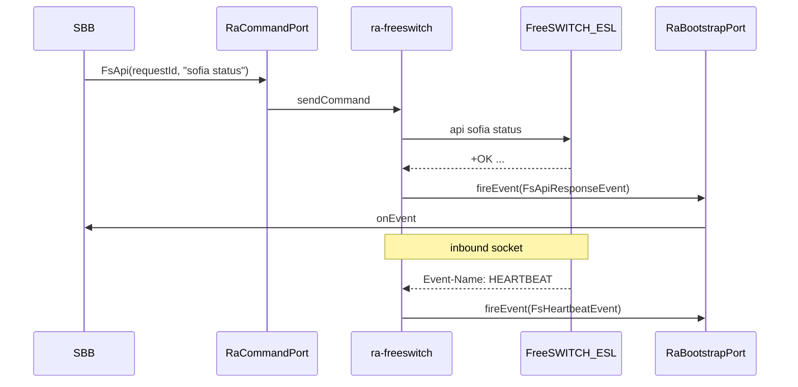

# ra-freeswitch — FreeSWITCH control RA

JAINSLEE vendor RA (`jain-slee/vendor-ras/ra-freeswitch`, artifact `com.microjainslee:ra-freeswitch`) for Elisa ↔ FreeSWITCH **control plane** (ESL). SIP stays on `ra-sip-servlet`.

**Hard lock:** FreeSWITCH is an **essential** lab/product component (MRF/AS + media/ICE/TURN). This RA must **not** be dropped, and “full IMS” must **not** treat FS as an optional feature flag. Soft-fail when ESL is down (`eslLive=false`) is lifecycle honesty — not permission to omit FS from compose (always `depends_on` for S-CSCF / combined Elisa; N–N = 1:1 S↔FS).

## Grill locks

| Q | Decision |
|---|----------|
| **A** | **vendor** — `jain-slee/vendor-ras/ra-freeswitch` (`com.microjainslee.ra.freeswitch`) |
| **B** | **1+2** — ESL sync (`FsApi`/`FsBgapi` + `FsApiResponseEvent`) **and** inbound `HEARTBEAT` / `CHANNEL_*` events |
| **C** | **2+3** — link activity `fs-link` for HEARTBEAT/API; per-channel `fs-ch-{uuid}` for `CHANNEL_*` (end on hangup/destroy) |

## 3-port contract

| Port | Role |
|------|------|
| `RaEndpointPort` | `activate` / `deactivate`; ESL connect lifecycle; name `freeswitch-ra` |
| `RaCommandPort` | Sealed `FsOutboundCommand` |
| `RaBootstrapPort` | `createActivityHandle`, `fireEvent`, `endActivity` |

## Activity model (C=2+3)

| Activity id | Events | End |
|-------------|--------|-----|
| `fs-link` | `FsHeartbeatEvent`, `FsApiResponseEvent` | RA `deactivate` |
| `fs-ch-{Unique-ID}` | `FsChannelEvent` | `CHANNEL_HANGUP` / `CHANNEL_HANGUP_COMPLETE` / `CHANNEL_DESTROY` |

## Commands / events (Phase 1)

| Direction | Type |
|-----------|------|
| Out | `FsApi(requestId, command)`, `FsBgapi(requestId, command)`, `FsSubscribe(events…)` |
| In | `FsApiResponseEvent`, `FsHeartbeatEvent`, `FsChannelEvent` |

## Non-goals

- Not an SBC / not RTP (media plane stays on FreeSWITCH — which remains **mandatory**)
- Not a second SIP stack toward FS (trunk = `ra-sip-servlet`)
- xml_curl stays Quarkus REST
- Do **not** remove this RA or gate “full IMS” behind FS-off flags

## Replace

`et.elisa.esl.EslClient` → bridge to RA sync helper, then SBB/`@InjectRa(name="freeswitch-ra")`.
