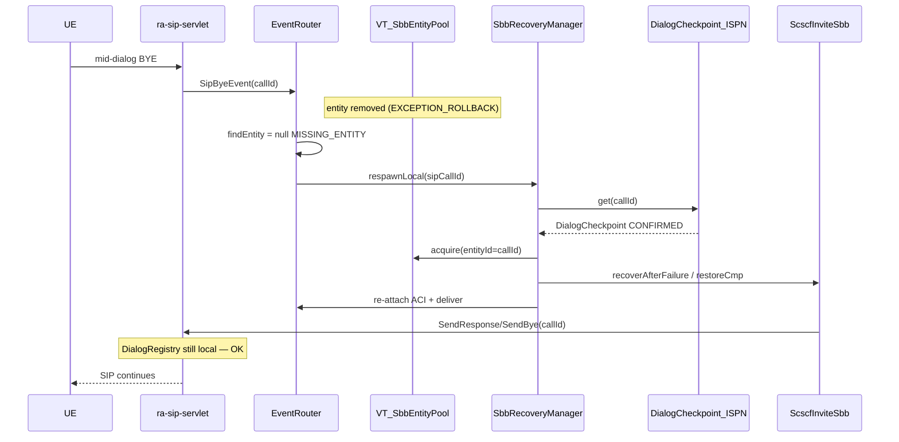
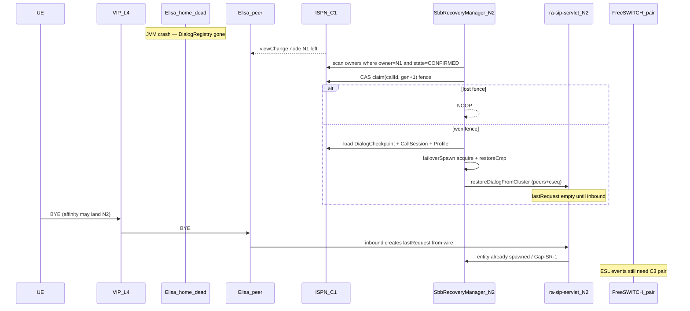

# SbbRecoveryManager — dead SBB detect + respawn

**Status:** P0 WIRED (2026-08-11) — view-change listener + `ClusterManager.adopt` (one ISPN view) + SipDialogHa restore on every spawn + BYE self-remove race guard + soft-hang watchdog + nn kill-test script. Not Clearwater Chronos. ProfileFacility is **not** failover SoT.  
**Product context:** Elisa lab IMS Core + FreeSWITCH MRF/AS; N–N cluster **C1** (Infinispan) / **C2** (VIP affinity) / **C3** (FS pair); target **10 000 INVITE/s** on `ra-sip-servlet`; host **JDK 25** micro-jainslee.  
**Related:** [`cmp-recovery.md`](cmp-recovery.md) (app CMP dual-write), [`jainslee-profile.md`](jainslee-profile.md), [`cluster-c2-vip-affinity.md`](cluster-c2-vip-affinity.md), [`ims-core.md`](ims-core.md) (I7 sticky), jain-slee ADR [`0002-ra-sticky-ha-fabric.md`](../../../../jain-slee/jain-slee/docs/adr/0002-ra-sticky-ha-fabric.md), `SessionRecoveryService` (Gap-SR-1), `DistributedSbbEntityPool`.

---

## 0. Why this manager exists

Call continuity requires more than “load CMP on next event”:

| Without a manager | Risk |
|-------------------|------|
| Entity recycled / exception-removed mid-dialog | Next SIP/FS event hits **MISSING_ENTITY**; event drop → stranded call |
| Node crash | Home sticky (I7) gone; peer must **claim ownership** + spawn before dual handlers |
| Dual spawn (split-brain) | Two SBBs answer same Call-ID → broken SIP SM / double ESL |

**SbbRecoveryManager** is the **orchestrator** that detects death, chooses **local respawn vs sticky-home failover**, restores state (ISPN→PG + Profile), and spawns a new entity bound to the same dialog correlate. It does **not** replace RA protocol HA.

```text
Detection → Decision (home sticky / fence) → Restore (ISPN→PG→Profile) → Spawn (pool + ACI) → Continue
```

---

## 1. Implementation map (this pass)

| Piece | Path | Status |
|-------|------|--------|
| Manager API | `et.elisa.recovery.SbbRecoveryManager` | **done** |
| CDI impl | `et.elisa.recovery.SbbRecoveryManagerImpl` | **done** — EntityRemovalBus async + Gap-SR-1 bind |
| Decision policy | `RecoveryDecisionPolicy` (R1/R2/R6) | **done** + unit tests |
| Ownership fence | `DialogOwner` + `DialogOwnerStore` (ISPN CAS gen) | **done** — dual-write from `DialogCmpPersistence.save` |
| Bootstrap wire | `ElisaBootstrap.wireSbbRecovery` | **done** — removal bus + Gap-SR-1 + `ElisaClusterViewBridge` + `ClusterManager.adopt` |
| RA portable peers + wire | `DialogRegistry.PortableDialogMeta` + `restorePortable` / `restoreDialog` / `restoreDialogFromCheckpoint` | **done** — peers+cseq+URI/tags; synthetic lastRequest/lastResponse for lab Send* |
| Soft-hang heartbeat | `onEntitySuspect` | **wired** — `SoftHangWatchdog` (stale local EARLY/CONFIRMED) |
| Admin orphan HTMX | — | not in this pass |
| Full SIP TX HA | Chronos-class dialog SM | **gap** — lab synthetic rebuild only; TCP affinity / first inbound still preferred |

### Grill R1–R10 compliance

| Id | Status |
|----|--------|
| R1 sticky home | **yes** — decision policy + checkpoint `elisaNodeId` |
| R2 primary partition | **yes** — `DialogOwnerStore.isPrimaryPartition()` (ISPN AVAILABLE) |
| R3 fencing CAS | **yes** — `generation` replace |
| R4 RA owns SIP HA | **yes** — manager asks RA restore; never invents Send* |
| R5 stable entity id | **yes** — `ScscfInviteSbb/{callId}` |
| R6 TERMINATED no respawn | **yes** |
| R7 checkpoint cadence | app write-through + RA Gate A (existing) |
| R8 off INVITE path | async VT executor on removal + `@ViewChanged` async listener |
| R9 FS pair | **yes** — `HomeEslRemapService` on `failoverSpawn`: ESL rebind to checkpoint `fsNodeId` via `sf_fs_pair`; home down → `eslLive=false` (no fake REGED, no RTP move). Unit-tested only — not a live N–N kill prove. |
| R10 rehydrate guard | `RECOVERING` ThreadLocal + SessionRecovery REHYDRATING |

---

## 2. What exists in the runtime (read-back)

### 2.1 Entity create / pool (micro-jainslee)

| Piece | Role |
|-------|------|
| `MicroSleeContainer` | Owns `VirtualThreadSbbEntityPool`, `EventRouter`, `EntityRemovalBus`, optional cluster pool bind |
| `VirtualThreadSbbEntityPool` | `acquire(sbbId)` → slot + VT; `release` / `releaseById` → recycle; `findEntity` for dispatch |
| `EventRouter.deliverEvent` | Routes to entity VT; on miss → `missingEntityCount` + **`SessionRecoveryService.tryRehydrateAndDeliver`** (S7) |
| `EntityRemovalBus` / `EntityRemovalEvent` | Reasons: `TIMER_EXPIRED`, `SBB_SELF_REMOVE`, `CASCADE_CHILD`, `OPERATOR`, **`EXCEPTION_ROLLBACK`**, `HOT_REDEPLOY` |
| `DistributedSbbEntityPool` | Wraps local pool; **RA-only** `checkpoint` → ISPN `SbbEntitySnapshot` (`generation` fence + `profileRefs` + ACI names) |
| `SessionRecoveryService` | **JVM-local** LRU of `RecoverySnapshot` for Gap-SR-1 |

**Hot path rule (ADR 0002):** SBB create/delete stays off HA; **RA** calls `checkpointSbbEntity` on create / state-changing continue. App CMP write-through (Elisa `DialogCmpPersistence`) is complementary, not a substitute for kernel snapshots.

### 2.2 Elisa app state already recoverable

| Tier | Key | Store |
|------|-----|--------|
| Dialog CMP | `sipCallId` | ISPN `DialogCheckpoint` + PG `sf_dialog_checkpoint` |
| Ownership fence | `sipCallId` | ISPN `elisa-dialog-owners` (`DialogOwner` gen) |
| Call session | `fsUuid` | ISPN `CallSession` + PG `sf_call_session` + Profile `CallSession` |
| Registration home (I7) | IMPU | ISPN `RegistrationHomeStore` + PG `ims_binding.home_scscf_node` |
| Profile | msisdn / fsUuid | `ProfileFacility` (`ImsSubscriber` / `CallSession`) |
| SIP peers (portable) | Call-ID | RA `RaSessionMeta` attrs + `DialogRegistry.PortableDialogMeta` |

Load order on restore: **ISPN → PG** (rehydrate ISPN on PG hit). Profile is cross-SBB lookup (C9); entity CMP holds handler pointers (`sipCallId` / `fsUuid` / `profileKey`).

---

## 3. N–N HA how it works (this pass)

```text
Node A (home)                          Node B (peer)
─────────────                          ─────────────
INVITE → CMP save + owner putIfAbsent
RA DialogRegistry + RaSessionMeta
  (peer/remotePeer/cseq attrs)
         │
         │  JVM crash / view: A left
         ▼
                              onClusterViewChange(departed=A)
                              tryClaim(callId, gen+1) ──lose→ NOOP
                                         │ win
                                         ▼
                              load CMP ISPN→PG + Profile
                              acquireEntity(ScscfInviteSbb/callId)
                              recoverAfterFailure
                              restoreDialogFromCheckpoint (SipDialogHa)
                              then restoreDialogFromCluster if ClusterManager bound
                              R9 HomeEslRemapService → ESL rebind to checkpoint fsNodeId
                              metric blocked_sip_ha if no lastRequest
         │
         │  mid-dialog BYE (C2 VIP may land on B)
         ▼
                              inbound recordInbound → lastRequest from wire
                              SendResponse works; call continues
```

| Scenario | App/SBB | SIP mid-dialog Send* |
|----------|---------|----------------------|
| Local SBB death, DialogRegistry intact | **yes** | **yes** |
| Node death, fence win, peers restored | **yes** | **after first inbound** (or blocked until then) |
| Split-brain dual claim | loser **NOOP** | N/A |

C2 VIP Call-ID affinity remains recommended so mid-dialog traffic prefers the home until failover completes.

---

## 4. Detection / decision / restore (unchanged design)

See historical sections below for sequence diagrams. Public API:

```java
boolean respawnLocal(RecoveryKey key, RecoveryCause cause);
boolean failoverSpawn(RecoveryKey key, long expectedGeneration);
void onClusterViewChange(ClusterView view);
void onEntitySuspect(String sbbId, long lastBeatEpochMs);
```

---

## 5. Remaining gaps

1. **SIP `lastRequest` / `lastResponse` objects** — synthetic rebuild from SipDialogHa; early INVITE without tags still blocked (`blockedSipHa`).
2. **C3 FS pair ESL remap** on failover — **wired (R9)**: `failoverSpawn` → `HomeEslRemapService` rebinds `freeswitch-ra` to checkpoint home `fsNodeId`. Media stays on home FS. Home ESL down stays `eslLive=false`. `EslFailoverService` still walks **this** node's pair only (pinned home is not replaced by another S-CSCF's FS). Unit tests only — not proven with `nn-midcall-kill.sh` in this pass.
3. **Admin HTMX orphan list** — not shipped.
4. **Kernel `SbbEntitySnapshot` prefer-newer merge** — app CMP is primary restore path today.
5. **Chronos-class dialog SM** — no.

---

## 6. Metrics

| Metric (counters on manager) | Meaning |
|------------------------------|---------|
| `localOk` / `localFail` | Local respawn outcomes |
| `failoverClaimWon` / `failoverClaimLost` | Fence CAS |
| `blockedSipHa` | Failover spawn OK but Send* needs wire |
| `EventRouter.missingEntityCount` / `rehydratedCount` | Gap-SR-1 |

---

## 7. Tests

| Test | Covers |
|------|--------|
| `RecoveryDecisionPolicyTest` | LOCAL / FAILOVER / NOOP matrix |
| `DialogOwnerStoreFenceTest` | R3 CAS dual-spawn |
| `SbbRecoveryManagerLocalTest` | local restore, TERMINATED noop, failover claim |
| `DialogRegistryPortableHaTest` (ra-sip-servlet) | peer export/restore round-trip |

---

## 8. Sequence diagrams (design)

### 8.1 Local SBB crash (D1 / Gap-SR-1) — same node



### 8.2 Node crash + remote respawn (D4/D5)



---

## 9. Doc map

| Doc | Relation |
|-----|----------|
| This file | Orchestrator + grill R1–R10 + implementation status |
| [`cmp-recovery.md`](cmp-recovery.md) | App CMP ISPN/PG restore primitives |
| [`jainslee-profile.md`](jainslee-profile.md) | Shared Profile vs entity CMP (C9) |
| [`cluster-c2-vip-affinity.md`](cluster-c2-vip-affinity.md) | Affinity until full SIP TX HA |
| jain-slee `SessionRecoveryService` | Local Gap-SR-1 |
| jain-slee ADR 0002 | RA sticky fabric / checkpoint authority |
