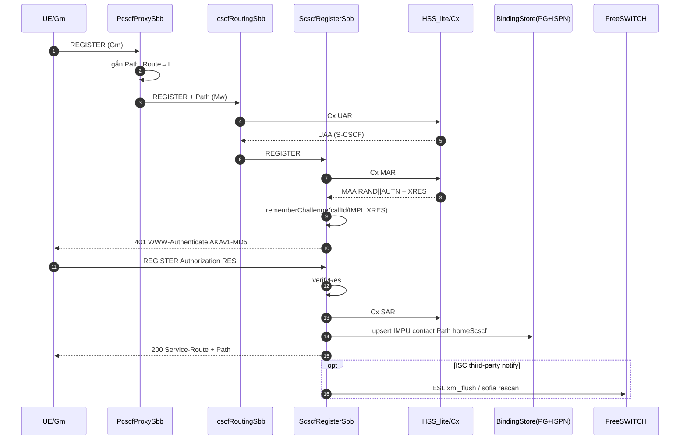
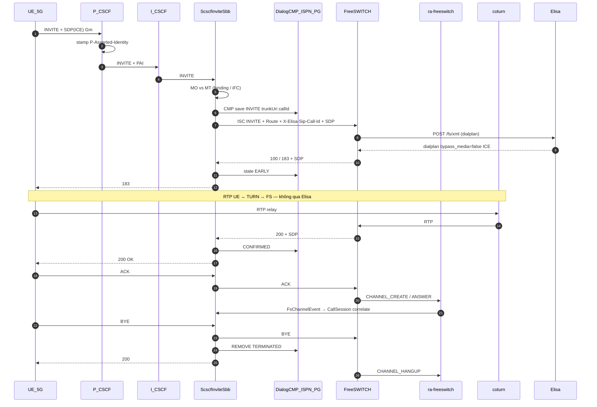
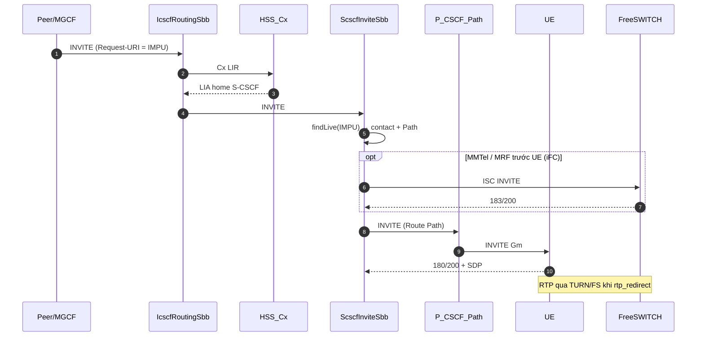
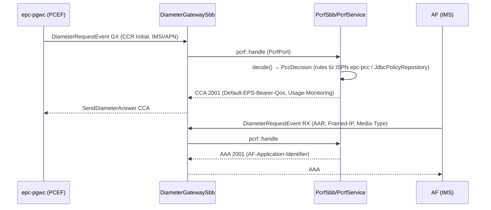

# Elisa (IMS) + FreeSWITCH (MRF) + EPC — Kiến trúc chi tiết & Mức độ sẵn sàng Production

> **Phạm vi tài liệu:** mô tả các thành phần trong repo `sip-freeswitch` — lõi IMS **Elisa**, media gateway **FreeSWITCH**, và mặt phẳng 4G **EPC** (HSS/SGW/PGW), cách chúng giao tiếp, các call-flow, kiến trúc dữ liệu (Postgres + Infinispan), và trạng thái sẵn sàng sản xuất thực tế (unit-proven vs. wire-proven/open).
>
> **Nguyên tắc trung thực:** "unit test xanh" ≠ "sống trên wire". Mọi khẳng định P1 cần phân biệt rõ **đã code + test đơn vị** so với **đã chạy thật trên mạng (PCAP / attach / gigabit)**. Các mục còn **open** đều được đánh dấu rõ.

---

## 1. Tổng quan hệ thống

`Elisa` là một **lõi IMS Core phòng-lab** (feature-flagged P/I/S-CSCF + HSS-lite tùy chọn) chạy trong **một process Quarkus / micro-jainslee (JDK 25)**. Nó **không phải SBC** — không relay RTP, không làm topology-hiding, không transcoding farm.

`FreeSWITCH` là **thành phần MRF/AS (Media Resource Function / Application Server) bắt buộc** — đảm nhận dialplan, media, ICE/TURN, xuất xml_curl. Elisa không thể được coi là "IMS đầy đủ" nếu thiếu FS.

`EPC` là **process anh em riêng (sibling)** — lõi 4G MVNO gồm HSS + SGW-C/U + PGW-C/U, KHÔNG chạy trong JVM Elisa. Mỗi dịch vụ EPC viết như một **micro-jainslee application** từ một image chung `epc-host` phân vai theo flag `EPC_ROLE_*`.

### Điểm trục chính (cách chúng kết nối)

```text
 UE (VoLTE/IMS)                  UE (4G data / VoLTE over LTE)
      │ Gm SIP                            │ S1-MME (eNB)
      ▼                                   ▼
 ┌──────────── nginx (edge) ────────┐   Host MME ──S6a──► DRA ──► epc-hss
 │  http :443 → Elisa :8088 (admin) │      │
 │  stream:5060 → Elisa :5060 (SIP) │      └──S11──► epc-sgwc ──Sxa──► sgwu
 └──────────────┬───────────────────┘                   │                │
                ▼                                       └──S5-C──► epc-pgwc └──S5-U──► pgwu ──SGi── PDN
          Elisa P/I/S-CSCF + HSS-lite                     │
                │ ISC + ESL (internal)                   Gx (Gx/Rx)      │
                ▼                                        ▼                │
          FreeSWITCH (MRF/AS)                          epc-pcrf           │
                │ RTP / ICE / TURN         IMS APN → Elisa P-CSCF ─────────┘
                ▼
         coturn ↔ FreeSWITCH RTP   (RTP KHÔNG đi qua Elisa, KHÔNG đi qua nginx)
```

| Thành phần | Plane | Sở hữu | Không sở hữu |
|-----------|-------|--------|--------------|
| **nginx** | Edge | HTTPS → `:8088`; SIP L4 stream → `:5060` (src-IP hash) | Không phải P-CSCF, không mang RTP |
| **Elisa** | SIP/Mw/ISC/Cx | CSCF roles, S6a client, HSS-lite, admin HTMX, ESL client, xml_curl, CDR, ACL | RTP/SRTP, GTP/PFCP/S6a/PCEF (thuộc EPC) |
| **FreeSWITCH** | Media + AS | MRF/AS, dialplan, Sofia (SIP trunk), ESL peer, media ports | Không điều khiển signaling RFC 3261 (Elisa giữ) |
| **coturn / ICE** | Media | TURN relay (rtp_redirect) | — |
| **postgres** | Dữ liệu | `elisa` (config, IMS bindings, CDR, dialog checkpoint) + `epc` (subscriber, secret, CDR, PCC, session checkpoint) | — |
| **Infinispan** | Cache/cluster | Elisa: `elisa-cluster` (dialog/registration/call-session); EPC: `epc-cluster` | Ki/OPc/SQN/vector — không cache crypto |
| **epc/** (sibling) | 4G CP | HSS (S6a+Cx), SGW-C/U, PGW-C/U, PCRF/PCEF | — |

---

## 2. Chi tiết từng thành phần

### 2.1 Elisa — lõi IMS (process `elisa`, Quarkus + micro-jainslee)

**Vai trò theo flag (`sf.ims.role.*`):** `pcscf`, `icscf`, `scscf`, `hss`. Tất cả `true` = node lab gộp; tách deploy = bật tập con (one image, many services).

#### Resource Adaptor (RA) — đường giao thức

| RA | Tên inject | Plane | Ghi chú |
|----|-----------|-------|---------|
| `ra-sip-servlet` | `sip-servlet-ra` | SIP Gm/Mw/ISC | Vendor; giữ trọn state-machine transaction/dialog RFC 3261. **Chỉ Elisa dùng — EPC cấm.** |
| `ra-freeswitch` | `freeswitch-ra` | ESL điều khiển FS | JAIN SLEE 3-port (`RaEndpointPort` + `RaCommandPort` + `RaBootstrapPort`). Soft-fail khi FS down (`eslLive=false`). **FS vẫn bắt buộc trong compose.** |
| `ra-diameter` | `diameter-ra` | Diameter Cx (và S6a phía EPC) | Vendor; `isPeerReady()` = đã CEA. Không có stack Diameter thứ hai. |

**`ra-freeswitch` (điều khiển FreeSWITCH qua ESL `:8021`):**
- **Contract 3-port:** `Activate/Deactivate`; lệnh outbound sealed (`FsApi`, `FsBgapi`, `FsSubscribe`); event inbound (`FsApiResponseEvent`, `FsHeartbeatEvent`, `FsChannelEvent`).
- **Activity model:** `fs-link` (dài hạn, HEARTBEAT + API response), `fs-ch-{Unique-ID}` (per channel, end khi `CHANNEL_HANGUP` / `CHANNEL_DESTROY`).
- **Không làm:** INVITE/BYE (giữ `ra-sip-servlet`), RTP, xml_curl (giữ Quarkus REST). Không chạy `new Disruptor<>()` — luôn `bootstrapPort.fireEvent()`.

#### Service Object (SBB) — xử lý call

| SBB | Vai trò |
|-----|---------|
| `PcscfProxySbb` | Gm: chặn REGISTER/INVITE, gắn P-Asserted-Identity, Route → I-CSCF |
| `IcscfRoutingSbb` | Mw: UAR/LIR đến HSS để chọn S-CSCF |
| `ScscfRegisterSbb` | AKA challenge (401), verify RES, SAR, lưu binding (IMPU→contact/Path/home-S-CSCF) |
| `ScscfInviteSbb` | MO/MT INVITE, iFC routing → FreeSWITCH, CMP dialog state |
| `RegistrationSbb` / `ProxySbb` | hỗ trợ REGISTER & proxying |
| `DiameterCxSbb` | Cx client/stub phía Elisa (DIA bridge) |
| `IceNegotiationSbb` | ép ICE + TURN relay khi rtp_redirect |
| `FreeSwitchMonitorSbb` | theo dõi FS (HEARTBEAT / CHANNEL_*) |
| `CallSessionSbb` | correlate call từ FS channel event, CDR |

#### IMS HSS / Cx (Elisa nội)

- `HssLiteService`, `CxServer`, `CxCodec`, `CxClient`, `ImsIdentityKeys`, `DiameterRaBridge` — đường Cx lab. Khi `SF_IMS_HSS=false` + `SF_IMS_CX_DEST_HOST=epc-hss` → Cx đi đến EPC HSS (seam). Mặc định lab giữ HSS-lite.
- IMS AKA: `et/elisa/ims/aka`, `digest` — TS 33.203.

#### Các module Elisa

| Module | Vai trò |
|--------|---------|
| `ims/reg` | service route, binding store (PG + ISPN) |
| `ims/scscf` / `icscf` / `pcscf` | CSCF roles |
| `ims/trunk` | trunk FS URI (`SF_TRUNK_FREESWITCH_URI`), ISC AS |
| `ims/mmtel` | MMTel settings (migration V7) |
| `ims/charging` | ICID/P-Charging-Vector, CDR correlation, pending charge (V5) |
| `cmp` | Dialog CMP (Infinispan + PG checkpoint) |
| `cluster` | `ElisaInfinispanManager` (JavaSerializationMarshaller + allow-list) |
| `media` | ICE/TURN config, rtp_redirect |
| `session` | call session + FS correlate |
| `capacity` | Capacity/SIPp |
| `acl` | signaling ACL |
| `tenant` | multi-tenant admin |

---

### 2.2 FreeSWITCH — MRF/AS bắt buộc

| Sở hữu | Chi tiết |
|--------|---------|
| Media | RTP/SRTP, transcoding, codec (chính sách qua SDP) |
| Dialplan | qua **xml_curl** `POST /fs/xml` (Elisa REST nội bộ); trả dialplan với `bypass_media=false` |
| Sofia | SIP trunk với Elisa (ISC): `SF_TRUNK_FREESWITCH_URI=sip:1000@freeswitch:5060` |
| ESL | `:8021`, nhận lệnh `FsApi`/`FsBgapi`, phát `HEARTBEAT`/`CHANNEL_*` |
| Media path | `rtp_redirect=true`, `bypass_media=false`, ICE + TURN qua coturn (`:3478`) |

**Ràng buộc cứng:** FS luôn có trong compose (`depends_on` cho elisa/scscf); N–N = **1:1 S-CSCF ↔ FreeSWITCH**; thiếu FS = không coi là "full IMS". Soft-fail ESL khi FS down là trung thực vòng đời, không phải cho phép bỏ FS.

---

### 2.3 EPC — process anh em (4G MVNO)

**Một image `epc-host`, nhiều dịch vụ theo flag `EPC_ROLE_HSS/SGWC/PGWC`.** PCEF là **library** (`epc-pcef`) nhúng trong `epc-pgwc` (không phải dịch vụ riêng). Mỗi dịch vụ là micro-jainslee app.

| Service | Role flag | Plane | Deploy |
|---------|-----------|-------|--------|
| `epc-hss` | `EPC_ROLE_HSS` | S6a + Cx (dedicated `postgres-epc`) | `deploy/epc/roles/hss.env` |
| `epc-sgwc` ×N | `EPC_ROLE_SGWC` | S11/S5 GTPv2-C + Sxa PFCP | `sgwc.env`, `sgwc-2.env` |
| `epc-pgwc` ×N | `EPC_ROLE_PGWC` | S5 + Sxb + PCEF + IPAM | `pgwc.env` |
| `sgwu`/`pgwu` | non-JVM | Linux GTP baseline (1:1 với C node) | compose `sgwu`, `pgwu`, `sgwu-2` |

**Caching/cluster (`EpcInfinispanManager`, `epc-cluster`):**
- Caches: `epc-sessions` (100k), `epc-subscribers` (200k), `epc-pcc` (200k).
- Mode `LOCAL` (lab) / `DIST_SYNC` (multi-node). Tuyệt đối không join `elisa-cluster`.
- Marshal: `JavaSerializationMarshaller` + allow-list. **Không cache crypto** (Ki/OPc/SQN/vector) — chỉ `key_ref` → `SecretStore`.

#### `epc-host` (EpcBootstrap / EpcRuntime) — datastore & wiring

**Postgres (datastore bật theo `epc.datastore.enabled`, mặc định true):**
- Quarkus Agroal named datasource `"epc"` (`jdbc:postgresql://postgres-epc:5432/epc`), driver PostgreSQL, Flyway `migrate-at-start`.
- Wire tại boot: `JdbcDurableSink` (session checkpoint) + `IspnSessionStore` ⇒ `DualWriteSessionStore`; `CachingHssRepository` (ISPN subscriber cache read-through `JdbcHssRepository`); `JdbcSecretStore` (kek-hex cho crypto); `IspnPccCache` + `JdbcPolicyRepository`; `JdbcCdrStore` (PCEF).
- Nếu DB/ISPN tắt ⇒ **fallback heap** (`HeapHssRepository` / `HeapSecretStore` / `HeapSessionStore`) — dùng cho test/lab nhanh, **không phải production**.

**Wiring SBB:**
- `DiameterGatewaySbb` — S6a/Cx/Gx/Rx: khi `wireS6a || wirePcef`, register + map `DiameterRequestEvent`. **PcrfPort seam:** Gx(16777238)/Rx(16777236) → `PcrfSbb.$Concrete(service)::handle` delegate (CCR→CCA, AAR→AAA, RAR→RAA, STR→STA).
- `GtpGatewaySbb` — GTPv2-C + PFCP: S11/S5 Create/Modify/Delete Session, PFCP program PDR/FAR/QER/URR trên Sxa/Sxb.

#### Mặt phẳng điều khiển (CP) theo module

| Module | Thành phần chính | Vai trò |
|--------|------------------|---------|
| `epc-hss` | `HssService`, `JdbcHssRepository`, `HssSbb`, `CxService`, `CxCommand/CxAvp`, `S6a*` | S6a (AIR/AIA + EPS-AKA, ULR/ULA, CLR/CLA, PUR/PUA, IDR/IDA, DSR/DSA, RSR/RSA, NOR/NOA) + Cx (UAR/MAR/SAR/LIR/RTR/PPR). SQN qua `UPDATE…RETURNING` (atomic, không shared vector). `S6aSubscriptionData`, `SubscriberRecord` (IMPI/IMPU/iFC/AMBR). |
| `epc-crypto` | `EpsAka`, `Milenage` (TS 35.208), `Kasme` | EPS-AKA vector sinh + AUTS resync |
| `epc-sgwc` | `SgwControl`, `SgwcSbb`, `SgwSessionEvent` | S11 ↔ MME, S5 ↔ PGW, PFCP Sxa. SgwSbb là micro-jainslee. |
| `epc-pgwc` | `PgwControl`, `PgwSbb`, `PgwsessionEvent`, `Ipam`, `CreateSessionResult` | S5 + Sxb + IPAM (cấp UE IP) + PCEF. PgwSbb micro-jainslee. |
| `epc-pcef` | `PcefService`, `Cdr/CdrStore/JdbcCdrStore`, `ChargingId`, `PolicyDecision`, `PcrfClient`, `UsageRecord` | Open/authorize/report/close/reconcile, Gx client, CDR (heap hoặc PG qua `JdbcCdrStore`) |
| `epc-pcrf` | `PcrfService`, `GxHandler`, `RxHandler`, `PccRule/PccDecision/PccCache`, `JdbcPolicyRepository`, `PcrfSbb` | Decision PCC (QoS), Gx CCR→CCA, Rx AAR→AAA/STR/RAR, read-through `JdbcPolicyRepository` vào ISPN `epc-pcc`. PcrfSbb micro-jainslee. |
| `epc-up-linux` | `UpfSbb`, `LinuxGtpAgent`, `LinuxGtpCommand`, `UpfProgramSessionEvent` | UP Linux GTP (PDR/FAR/QER/URR); agent gọi `gtp` kernel/`ip` command. UpfSbb micro-jainslee. |

---

## 3. Cách các module giao tiếp với nhau

### 3.1 Ma trận giao tiếp (Elisa ↔ FS ↔ EPC)

| Từ | → Đến | Giao thức | Port | Mục đích |
|----|-------|-----------|------|----------|
| UE | Elisa (nginx) | SIP Gm TCP/TLS (hoặc UDP lab) | `:5060` | REGISTER / INVITE |
| Browser | nginx → Elisa | HTTPS → HTTP | `:443 → :8088` | Admin HTMX, xml_curl, ice-config |
| UE | coturn/FS | RTP/SRTP/ICE/TURN | `3478`, FS `16384-16484` | Media — **không qua Elisa/nginx** |
| Elisa CSCF | FreeSWITCH | SIP ISC (trunk Sofia) | FS `:5060` | ISC INVITE `sip:1000@freeswitch` |
| Elisa | FreeSWITCH | ESL (FsApi/Bgapi) | `:8021` | Điều khiển FS (ra-freeswitch) |
| FreeSWITCH | Elisa | HTTP xml_curl | `:8088 /fs/xml` | Fetch dialplan/directory |
| Elisa | Infinispan | Hot Rod / embedded | — | Dialog + registration + call-session CMP |
| Elisa | Postgres | JDBC | `5432` | Profiles, bindings, CDR, checkpoint |
| Elisa Cx | EPC HSS | Diameter Cx (qua `ra-diameter`) | — | Khi `SF_IMS_HSS=false` + `SF_IMS_CX_DEST_HOST=epc-hss` |
| MME | EPC HSS | Diameter S6a | — | Fetch subscriber + vector + dereg |
| MME | EPC SGW-C | GTPv2-C S11 | `2123` | Tạo / sửa / xoá session |
| SGW-C | PGW-C | GTPv2-C S5-C | `2123` | Bearer PGW |
| SGW-C/PGW-C | sgwu/pgwu | PFCP Sxa/Sxb | — | Lập trình PDR/FAR/QER/URR |
| PGW-C | PCRF | Diameter Gx | — | Policy & charging (CCR/CCA) |
| AF/IMS | PCRF | Diameter Rx | — | QoS preconditions (AAR/AAA) |
| PGW-C | OCS/OFCS | Gy/Gz/Rf (ra ngoài) | — | Charging ACR/CDR (PCEF) |

> **Seam Cx (Elisa ↔ EPC):** file `deploy/elisa/roles/scscf-cx-epc.env` đặt `SF_IMS_HSS=false` + `SF_IMS_CX_DEST_HOST=epc-hss` — Elisa không đổi code, chỉ đổi config để Cx đi vào EPC HSS.

### 3.2 In-process (micro-jainslee)

- **Event routing:** RA phát `*Event` → container `mapEventToSbb` → SBB `onEvent` → `ActivityContext.fireEvent` / `aci.fireEvent()`. Không `new Disruptor<>()` bên ngoài vendor RA.
- **Port model:** SBB ↔ RA qua port (`RaCommandPort.sendCommand` outbound; `RaBootstrapPort.fireEvent` inbound). VD: `DiameterGatewaySbb` dùng `DiameterPeerPort`; call FS qua `RaCommandPort.sendCommand(FsApi)`.

---

## 4. Call flow

### 4.1 REGISTER (IMS AKA) — combined node + FS notify



- Binding chính: `ims_binding.home_scscf_node` → **sticky** registration về đúng S-CSCF node; dialog checkpoint trong ISPN `elisa-cluster`.
### 4.2 MO INVITE — full FreeSWITCH (ISC + xml_curl + ESL + RTP)



### 4.3 MT INVITE — peer → home S-CSCF → UE (optional MRF)



### 4.4 EPC attach / tạo session (S6a + S11 + S5 + PFCP)

```mermaid
sequenceDiagram
  autonumber
  participant MME as MME
  participant HSS as epc-hss
  participant S as epc-sgwc
  participant G as epc-pgwc
  participant SGWU as sgwu
  participant PGWU as pgwu

  MME->>HSS: S6a AIR (IMSI)
  HSS->>HSS: EpsAka/Milenage sinh vector (AUTS resync) — SQN update RETURNING
  HSS-->>MME: AIA (RAND,AUTN,XRES,KASME)
  MME->>HSS: S6a ULR
  HSS-->>MME: ULA (Subscription-Data)
  MME->>S: S11 Create Session (IMEI+APN)
  S->>S: chọn PGW / PDN
  S->>G: S5-C Create Session
  G->>G: IPAM cấp UE IP; PCEF open + authorize (Gx→PCRF nếu peerReady)
  G->>PGWU: Sxb PFCP Session Est (PDR/FAR/QER/URR)
  PGWU-->>G: Sxb Rsp (FTEID UP)
  G->>S: S5-C Rsp (PGW FTEID)
  S->>SGWU: Sxa PFCP Session Est
  SGWU-->>S: Sxa Rsp (SGW FTEID)
  S-->>MME: S11 Create Session Rsp (bearer + UE IP)
  MME->>S: S11 Modify Bearer (S1-U teid)
  S-->>SGWU: Sxa modify (EBI/F-TEID S1-U)
  Note over SGWU,PGWU: S1-U → SGW-U → S5-U → SGi → PDN (Linux GTP)
  Note over G,PGWU: PCEF report usage → CDR (heap/PG) + reconcile
```

> **Trạng thái:** S6a/ULR+vector, S11 Create/Modify/Delete, S5-C, Sxa/Sxb PFCP, IPAM, PCEF đều **unit-tested** (`EpcSleeLayeringTest`, `GtpGatewaySbbTest`, `SgwControl/PgwControl`…). **Wire attach đang open** (xem §6).

### 4.5 Gx/Rx — PCRF ↔ PCEF/AF



---

## 5. Kiến trúc dữ liệu — Postgres & Infinispan

### 5.1 Postgres Elisa (DB `elisa`) — Flyway V1..V9

| Migration | Nội dung |
|-----------|----------|
| V1 | baseline (config, tenants, profiles, bindings) |
| V2 | CDR + ICID (P-Charging-Vector) |
| V3 | FreeSWITCH trunk SIP |
| V4 | `dialog_checkpoint` (SIP HA / N–N) |
| V5 | `pending_charge` (deferred charging khi OCS down) |
| V6 | CDR IMS fields |
| V7 | MMTel settings |
| V8 | SIP ACL docker bridge |
| V9 | `ims_binding` flow (IMPU → home_scscf_node, Path) |

### 5.2 Postgres EPC (DB `epc`) — Flyway V1..V4

| Migration | Nội dung |
|-----------|----------|
| V1 | `epc_subscriber` (subscriber, APN, QoS, key_ref) |
| V2 | `epc_secret` (KEK-encrypted secret), `epc_pcef_cdr`, `epc_session_checkpoint` |
| V3 | `epc_ims_identity` (IMPI/IMPU/iFC/AMBR) — hỗ trợ Cx |
| V4 | `epc_pcc` (policy) |

> **Lưu ý:** schema EPC sống trên DB `epc` riêng (postgres-epc), không bao giờ trên `elisa`/`ussdgw`. KHÔNG dùng H2. Crypto (Ki/OPc/SQN/vector) KHÔNG xuống SQL — chỉ `key_ref`; secret được mã bằng kek-hex trong `epc_secret`.

### 5.3 Infinispan

| Cluster | Caches | Nội dung |
|---------|--------|----------|
| `elisa-cluster` | dialog, registration, call-session | CMP (checkpoint dialog), binding home-S-CSCF |
| `epc-cluster` | `epc-sessions`, `epc-subscribers`, `epc-pcc` | Dual-write session checkpoint, HSS read-through cache, PCC cache |

- Hai cluster **cách ly tuyệt đối**. Marshal `JavaSerializationMarshaller` + allow-list.
- Dual-write: `DualWriteSessionStore` (hot cache + PG sink `epc_session_checkpoint`) — sink chạy **off hot-path** qua executor.

---

## 6. Mức độ sẵn sàng Production (production readiness)

> **Thang đo:** ✅ unit+integration test xanh · 🧪 code có nhưng wire/open · ❌ chưa có / gap. Không có "✅ production" nào được khẳng định từ unit test đơn lẻ — cần **prove artifact trên host + wire PCAP/attach + soak**.

### 6.1 IMS / VoLTE-lab (Elisa + FreeSWITCH)

| Hạng mục | Trạng thái | Ghi chú |
|----------|-----------|---------|
| SIP REGISTER / INVITE (Gm) | ✅ unit + smoke PCAP ims-smoke | `tools/ims-smoke.sh` fail-closed; PCAP `sip.Method==REGISTER` / `401` |
| nginx ingress (http+stream) | ✅ code+config | — |
| FreeSWITCH control (ra-freeswitch) | ✅ code+unit | ESL soft-fail `eslLive=false`; FS mandatory |
| xml_curl dialplan | ✅ code | Quarkus REST `/fs/xml` |
| IMS AKA + Cx (Elisa) | ✅ code | MAR/SAR/UAR; verify RES |
| HSS-lite ↔ epc-hss seam | ✅ seam + config | Cx đi EPC khi `SF_IMS_CX_DEST_HOST=epc-hss`; **chưa wire-prove** |
| ICE/TURN/rtp_redirect | ✅ code+config | RTP không qua Elisa/nginx |
| N–N dialog recovery (CMP/ISPN) | ✅ code + kill-test | **open HA thật ngoài lab** |
| Charging (Rf stub / CDR ICID) | ✅ code | SessionS/Gy/Gx **out** theo grill (IMS side) |

### 6.2 EPC (4G)

| Hạng mục | Trạng thái | Ghi chú |
|----------|-----------|---------|
| S6a (AIR/ULR/CLR/PUR/IDR/DSR/RSR/NOR) | ✅ unit (PICS-M present) | SQN atomic `UPDATE…RETURNING` |
| EPS-AKA / Milenage / Kasme | ✅ unit (TS 35.208, 421 crypto tests) | — |
| GTPv2-C S11/S5 (Echo, Create/Modify/Delete, RAB, DDN) | ✅ unit | ra-gtpv2c peer-live = Echo Response |
| PFCP Sxa/Sxb (program PDR/FAR/QER/URR) | ✅ unit | `PfcpProgramSession` |
| IPAM / PGW-C | ✅ unit | UE IP cấp, sessions |
| PCEF (open/authorize/report/close/reconcile) | ✅ unit | CDR heap/PG |
| Gx/Rx → PCRF (PcrfPort seam) | ✅ unit + wired | CCR→CCA, AAR→AAA |
| Postgres datastore + Flyway + ISPN | ✅ wired (Gap-A) | `JdbcDurableSink`, CachingHss, JdbcSecret, IspnPcc, JdbcCdr |
| `epc-up-linux` (GTP-U thật) | 🧪 code | sgwu/pgwu **vẫn placeholder** (alpine sleep); LinuxGtpAgent có nhưng **chưa có container GTP kernel**, chưa S1-U/S5-U/SGi |
| **Wire attach (G3)** | ❌ **open** | Chưa S6a+S11 attach với MME thật; unit ≠ attach |
| **ra-diameter peer route** | ❌ **gap (P0)** | `DiameterRaConfig` chưa có `setPeerHost`/peer-route ⇒ S6a thật & Cx Elisa→epc-hss **chưa thể route**. |
| HA SGW-C/PGW-C + sgwu-2/pgwu-2 | ❌ open | `pgwc-2` chưa có; kill-recovery chưa prove |
| Gigabit / 10k contexts | ❌ open | `pilot-acceptance.sh` viết `results/<ts>.json` nhưng UP/attach chưa thật |
| VoLTE QoS (Rx dedicated bearer) | ❌ ngoài scope P1 | `volte-rx.md` — cần nay thật |
| Package-dist / artifact prove | ✅ (gate script có) | `package-dist-epc.sh` → `dist/epc`; runner ghi mtime |

### 6.3 Tóm tắt mức sẵn sàng

| Plane | Mức | Chặn P1 |
|-------|-----|---------|
| **Elisa IMS signaling** | Lab-ready (unit+smoke) | Cx→EPC wire chưa |
| **FreeSWITCH media** | Lab-ready | — |
| **EPC S6a/HSS (CP)** | Unit-complete | **Peer route (ra-diameter) — open** |
| **EPC GTP-C + PFCP (CP)** | Unit-complete | Wire attach **open** |
| **EPC UP (S1-U/S5-U/SGi)** | ❌ placeholder | **Cần `epc-up-linux` thật** |
| **EPC Gx/Rx PCRF** | Unit-complete + wired | Wire đến PCRF/OCS chưa |
---

## 7. Những gì còn thiếu để lên Production P1 (gap checklist)

1. **Diameter peer seam (chặn lớn nhất, P0).** `ra-diameter` (hoặc `DiameterPeerPort`) thiếu outbound peer config: `setPeerHost/port/realm`, khởi tạo CER, route answer/request về peer. Thiếu cái này ⇒ cả S6a thật và Cx Elisa→epc-hss **không thể kết nối được**. Wire từ env `EPC_S6A_PEER_HOST`/Cx dest; `LinkStatusBoard` chỉ hiện `isPeerReady()`=CEA, không lấy LISTEN làm UP.
2. **UP GNU thật (`epc-up-linux`).** sgwu/pgwu hiện là `alpine sleep`. Cần container kernel `gtp` / bridge qua `LinuxGtpAgent`, PFCP lập trình PDR/FAR/QER/URR thật trên sgwu/pgwu, luồng S1-U/S5-U/SGi (IPv4+IPv6) + optional SGi NAT. Đây là hạng mục tạo ra "data flow" cho acceptance.
3. **Wire attach E2E (close G3).** Dùng `loadtest/ims-tools/open5gs` MME làm MME test: S6a AIR/ULR + S11 Create Session + Modify Bearer + PFCP Session Est (Sxa+Sxb) + S1-U data; lưu `epc/loadtest/pcaps/epc-attach-<ts>.pcap`. **Chỉ sau (1)+(2)** mới chạy được.
4. **Charging thật.** Gx→PCRF (hoặc static-deny) & Gy/Rf ACR→OCS/OFCS khi `peerReady`; CDR heap→PG (`CdrStore`→`JdbcCdrStore`) + reconcile không double-debit, claim-by-charging-id.
5. **HA + operator hardening.** Thêm `pgwc-2` + `sgwu-2`; `DIST_SYNC` trên `epc-cluster`; TEID high-byte node index; prove kill-recovery (SGW-C/PGW-C) với session restore từ checkpoint; `package-dist-epc.sh` + restart `:8099` + jar mtime (prove artifact).
6. **Acceptance ghi kết quả thật.** `pilot-acceptance.sh`/`epc-acceptance.sh` hiện chứng minh các gate chạy được (JDK25, mvn test, package mtime, wire **optional**). Muốn "P1 sẵn sàng" phải có results với **10k contexts, full-duplex 1–2 Gbit/s, IPv4+IPv6, mobility, charging reconcile, kill recovery** — thiếu thì **fail closed**.
7. **Không có silent claims.** Không VoLTE QoS nếu Rx chưa thật; không 10G trên Java 1 node; không HA nếu chưa kill-prove; không lấy NextEPC 30G làm chứng 4G; không "attach GO" chỉ từ unit test.

### Khuyến nghị thứ tự (theo `docs/agents/epc-p1.md`)

```
Phase 0  Diameter peer seam (setPeerHost / peer route)   → unblock mọi thứ
Phase 1  epc-up-linux thật (GTP-U) cho sgwu/pgwu
Phase 2  open5gs MME wire-attach PCAP (close G3)
Phase 3  PCEF Gx/Gy + PG CDR + reconcile
Phase 4  pgwc-2 HA + kill-recovery + package-dist-epc + results
Phase 5  acceptance run + báo cáo trung thực
```

---

## 8. Constraints đã khoá (không đổi)

- **JDK 25** chỉ (mise `zulu-25`). Không Java 8/11/17/21.
- Không bao giờ `new Disruptor<>()` bên ngoài RA — luôn `bootstrapPort.fireEvent()`.
- RA mới không `extends AbstractResourceAdaptor` — dùng 3-port `RaEndpointPort`+`RaCommandPort`+`RaBootstrapPort`.
- Diameter S6a/Cx/Gx/Gy → **`ra-diameter` duy nhất**; SIP → **`sip-servlet-ra` duy nhất**; `epc-host` **cấm** `ra-sip-servlet`.
- Không GTP-U/S11/S6a/PFCP/PCEF bên trong JVM Elisa. UP không phải Java.
- `epc-cluster` không bao giờ join `elisa-cluster`. DB `epc` riêng; không H2.
- Mỗi dịch vụ EPC viết dưới dạng micro-jainslee application (`*Main` + `*App` + SBB + event + `@EventType`).
- Commit/push: nhanth87 / Tran Nhan. Không rsync `dist/*` lên host production mà chưa hỏi operator.
- Hot-path: không INFO dump body SIP/ESL đầy đủ. Log4j2 (không JUL/SLF4J).

---

## 9. Tài liệu liên quan

- Kiến trúc tổng: `docs/agents/architecture.md`
- IMS call flows / role flags: `docs/agents/ims-core.md`
- Edge/nginx: `docs/agents/nginx-ingress.md`
- ra-freeswitch (ESL): `docs/agents/ra-freeswitch.md`
- Media/ICE/TURN: `docs/agents/media-ice-turn.md`
- EPC sibling: `docs/agents/epc.md`, `epc/AGENTS.md`
- EPC P1 plan (gap/phases): `docs/agents/epc-p1.md`
- Datastore/profile: `docs/agents/datastore.md`, `docs/agents/jainslee-profile.md`
- Charging/CGRates: `docs/agents/ims-core.md` § Charging · `docs/agents/elisa-improve-plan.md`
- Capacity: `docs/agents/capacity-acceptance.md`, `docs/agents/capacity-1m.md`, `epc/docs/agents/capacity-64c-10g.md`
> Đã wire seam PcrfPort tại boot (xem §2.3). Khi không có PCRF → trả mã lỗi theo app.